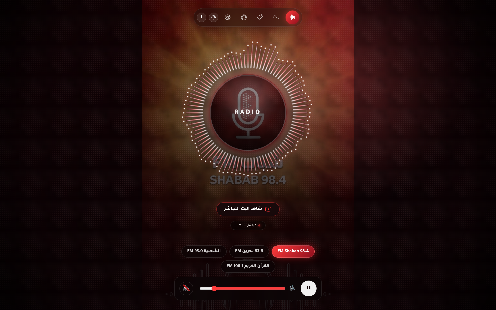
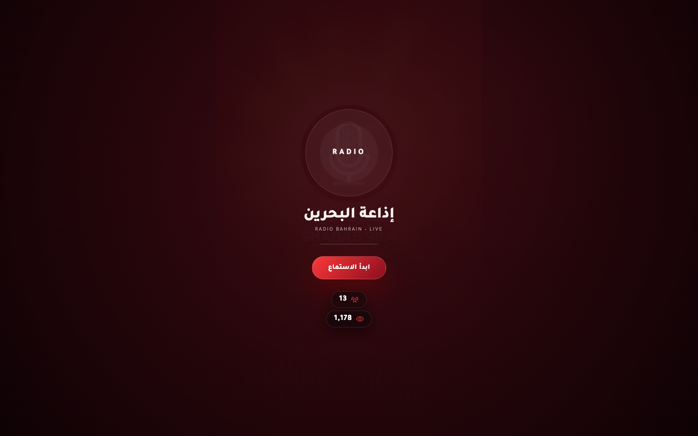
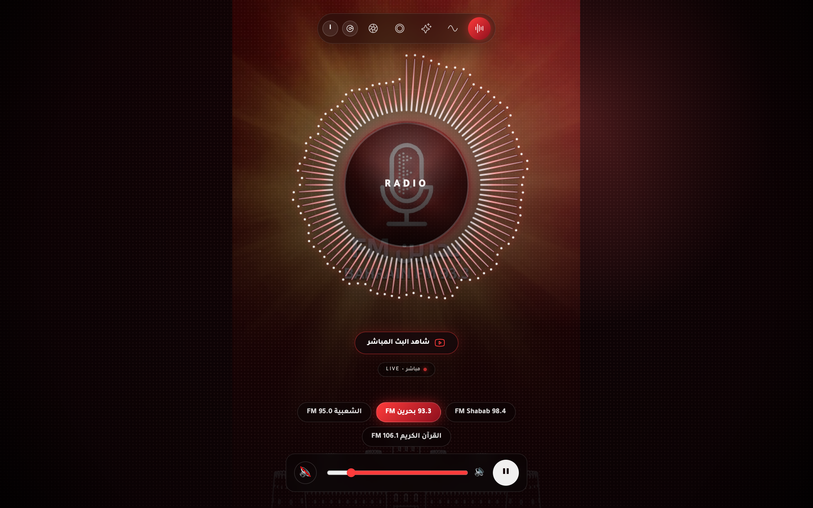
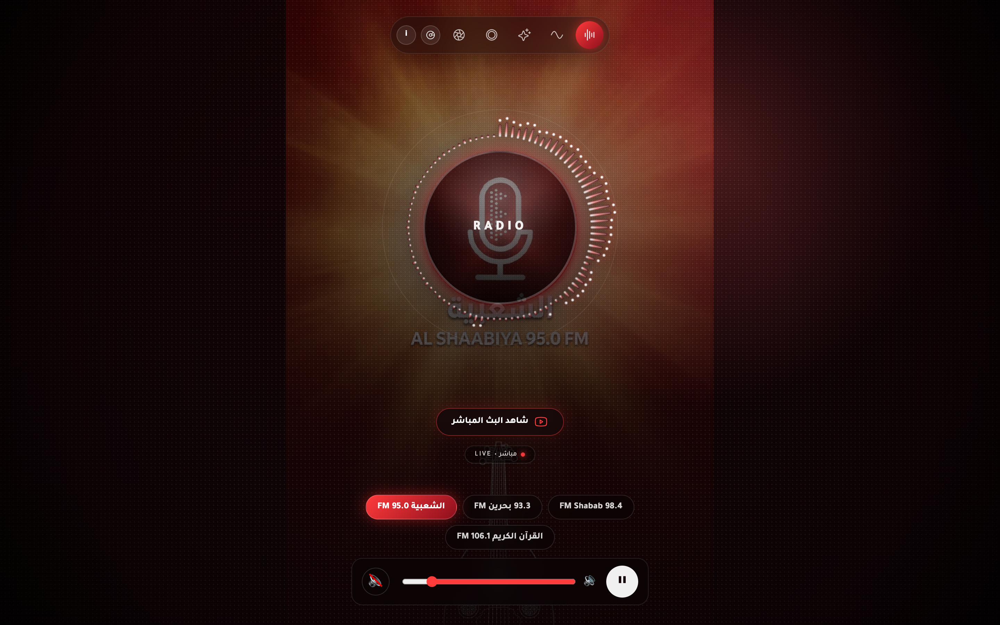
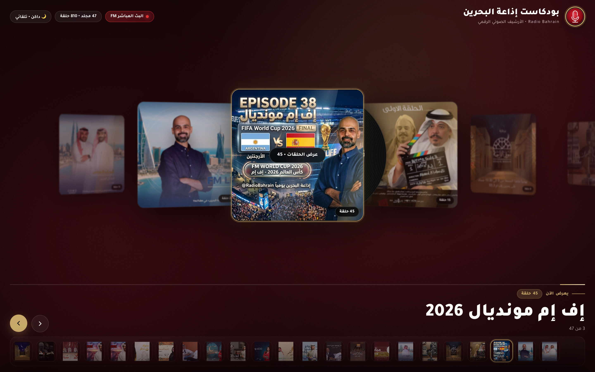
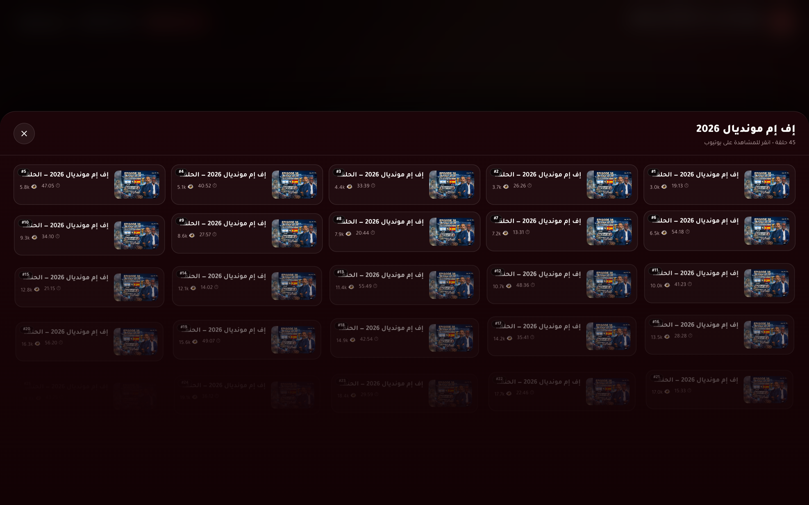
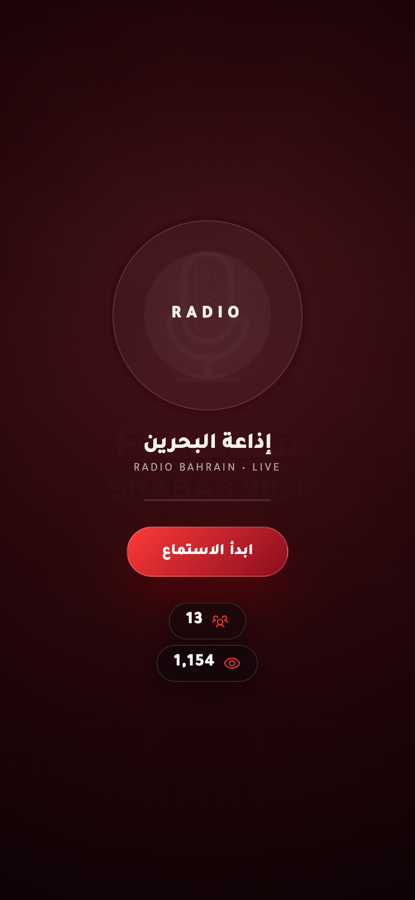
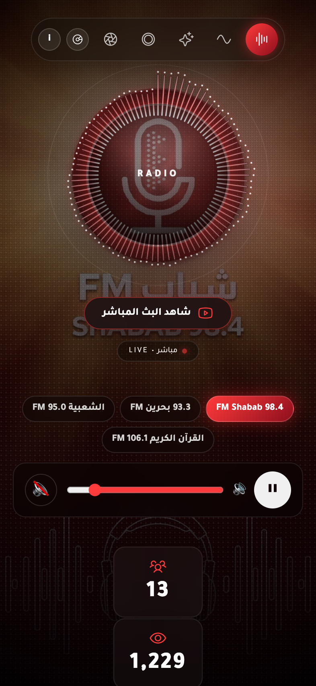
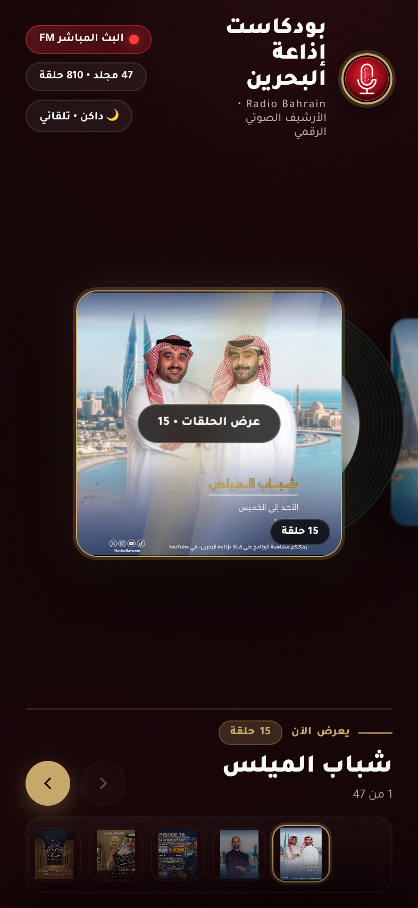

# مشغل إذاعة البحرين والأرشيف الصوتي الرقمي ثلاثي الأبعاد

**[English README](./README.md)** • **[نظرة تقنية شاملة (Technical Overview)](./docs/player-overview.md)**

مشغل بث إذاعي مباشر وأرشيف بودكاست رقمي ثلاثي الأبعاد لـ **إذاعة مملكة البحرين (Radio Bahrain)**، يعمل بالكامل عبر بيئة **Bun** المحلية مع شاشة ترحيب سينمائية، ومؤثرات موجات صوتية تفاعلية، ومحاذاة بصرية دقيقة لشعارات المحطات، وأرشيف أسطوانات فينيل ثلاثي الأبعاد (`/podcasts`).



---

## جولة بصرية في التطبيق

### 1. مشغل البث الإذاعي المباشر (`/`)

| شاشة البداية السينمائية | إذاعة شباب 98.4 FM (موجات صوتية حية) |
| :---: | :---: |
|  |  |

| إذاعة بحرين 93.3 FM | الإذاعة الشعبية 95.0 FM |
| :---: | :---: |
|  |  |

### 2. أرشيف بودكاست إذاعة البحرين ثلاثي الأبعاد (`/podcasts`)

| عرض الألبومات ثلاثي الأبعاد (Cover-Flow) وأسطوانة الفينيل | درج الحلقات التفاعلي |
| :---: | :---: |
|  |  |

### 3. تجربة الهواتف الذكية (تطابق بصري تام للشعار)

| شاشة البداية للهاتف | المشغل المباشر للهاتف (`393×852`) | أرشيف البودكاست للهاتف |
| :---: | :---: | :---: |
|  |  |  |

---

## أبرز المميزات

- **اعتمادية محلية كاملة عبر Bun**: جميع المكتبات البرمجية (`gsap`، `hls.js`) وخطوط `Tajawal` مُضمّنة محلياً دون الحاجة لأي روابط CDN خارجية أثناء التشغيل.
- **تطابق هندسي دقيق لشعار الميكروفون**: حساب ديناميكي لأبعاد وموضع خلفية كل محطة (`--bg-size` و`--bg-pos`) بحيث يتطابق قرص الميكروفون في الخلفية بدقة البكسل خلف زر التشغيل الدائري (`RADIO`) على جميع شاشات الحواسيب والهواتف الذكية.
- **مؤثرات طيف صوتي متعددة الأنماط**: 4 أنماط بصرية حية (أعمدة دائرية، موجات ناعمة، حلقات متداخلة، وجسيمات مضيئة) تعمل عبر Web Audio API.
- **التنقل السلس بين محطات إذاعة البحرين**:
  - **شباب FM 98.4**
  - **بحرين FM 93.3**
  - **الشعبية FM 95.0**
  - **القرآن الكريم FM 106.1**
- **اكتشاف البث المرئي المباشر على يوتيوب**: التحقق التلقائي من قناة `@Radio-Bahrain` وتضمين البث المرئي المباشر مع إيقاف الصوت الإذاعي تلقائياً لمنع التداخل.
- **أرشيف البودكاست ثلاثي الأبعاد (`/podcasts`)**:
  - استعراض الألبومات بتقنية 3D Cover-Flow بسرعة 60 إطاراً في الثانية مع أسطوانة فينيل متحركة تدور تلقائياً عند اختيار الألبوم.
  - دعم التمرير بعجلة الفأرة، السحب باللمس، لوحة المفاتيح، وشريط الصور المصغرة السفلي.
  - درج حلقات منزلق يفتح قائمة التشغيل الرسمية على يوتيوب مباشرة.
  - دعم الوضع الداكن والفاتح تلقائياً أو يدوياً.
- **حزمة أيقونات الموقع وتطبيق الويب (Favicons & PWA)**: أيقونات متجهة (`favicon.svg`) ومتعددة الأحجام (`favicon.ico`، `apple-touch-icon.png`، `site.webmanifest`) مستوحاة من شعار ميكروفون إذاعة البحرين.

---

## التشغيل المحلي

تأكد من تثبيت [Bun](https://bun.sh/) على جهازك، ثم نفّذ الأوامر التالية:

```bash
# تثبيت الاعتماديات
bun install

# تشغيل خادم التطوير المحلي
bun run dev
```

افتح المتصفح على:
- **المشغل الإذاعي المباشر**: `http://localhost:3000/`
- **أرشيف البودكاست ثلاثي الأبعاد**: `http://localhost:3000/podcasts`

### التشغيل في بيئة الإنتاج

```bash
bun run start
```

---

## الاختبارات الآلية الشاملة (E2E) وتوليد لقطات الشاشة

يحتوي المشروع على حزمة اختبارات شاملة (`tests/e2e.test.ts`) مبنية باستخدام `bun:test` و`puppeteer-core` للتحقق البصري والهندسي من محاذاة الشعار على سطح المكتب والهاتف، واختبار مسار `/podcasts`، وحفظ لقطات شاشة عالية الدقة في مجلد `screenshots/`:

```bash
# تشغيل اختبارات E2E وتحديث الصور التوضيحية
bun test

# أو تشغيل سكربت التقاط الصور مباشرة
bun run screenshots
```

---

## البناء والنشر

```bash
# بناء النسخة الثابتة في مجلد dist/
bun run build

# التحقق من جاهزية النشر دون رفع الملفات
bun run deploy:dry

# النشر الكامل مع تحديث رقم الإصدار تلقائياً
bun run deploy
```

---

## الرخصة

هذا المشروع مرخص بموجب رخصة MIT.
