<div align="center">


# Radio Bahrain Player & 3D Podcasts Archive
### إذاعة مملكة البحرين • البث الإذاعي المباشر والأرشيف الصوتي الرقمي ثلاثي الأبعاد

**[النسخة العربية (Arabic README)](./README.ar.md)** • **[Technical & Architectural Overview](./docs/player-overview.md)** • **[Live Production Demo](https://boreal-anchor-mg6e.here.now/)**


A self-contained, Bun-powered live radio broadcast player and interactive 3D digital podcasts archive for **Radio Bahrain (إذاعة مملكة البحرين)**. Engineered with a cinematic preloader splash, a 5-mode Web Audio API frequency visualizer, mathematically pixel-locked station artwork transitions, automatic YouTube Live broadcast coordination, and a 60fps **3D Vinyl Cover-Flow Archive (`/podcasts`)**.

</div>

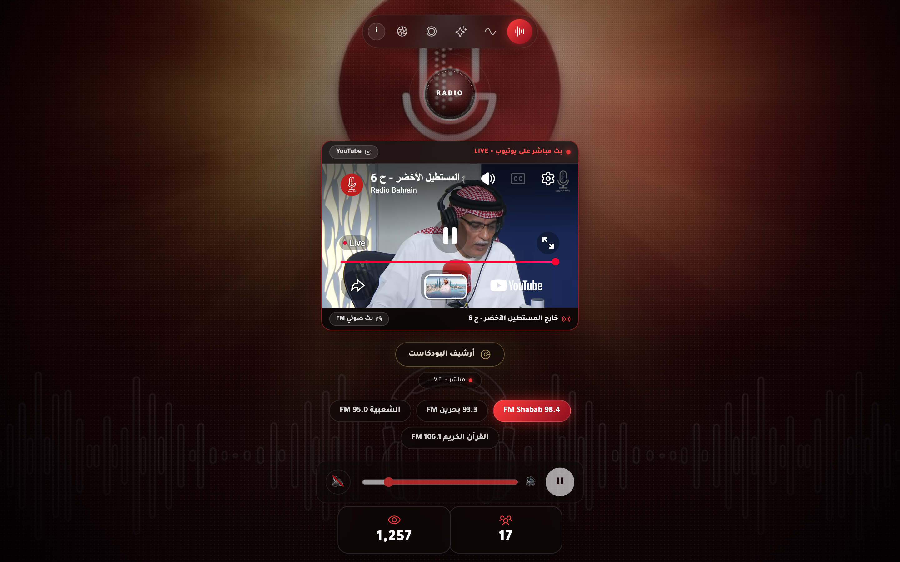

---

## Table of Contents

1. [Visual Tour & Screenshot Gallery](#1-visual-tour--screenshot-gallery)
   - [Live Radio Broadcast Player (`/`) — All 4 Official FM Stations](#11-live-radio-broadcast-player----all-4-official-fm-stations)
   - [3D Vinyl Podcasts Archive (`/podcasts`) — Dark & Light Themes](#12-3d-vinyl-podcasts-archive-podcasts--dark--light-themes)
   - [Mobile Responsive Experience (`393×852` Retina)](#13-mobile-responsive-experience-393852-retina)
2. [System Architecture](#2-system-architecture)
3. [Engineering Highlights & Key Features](#3-engineering-highlights--key-features)
   - [Pixel-Locked Station Artwork Solver (`BG_ART`)](#31-pixel-locked-station-artwork-solver-bg_art)
   - [5-Mode Web Audio API Spectrum Visualizer](#32-5-mode-web-audio-api-spectrum-visualizer)
   - [3D Cover-Flow Vinyl Physics & Active-Only Specular Shine](#33-3d-cover-flow-vinyl-physics--active-only-specular-shine)
   - [Universal Static & Dynamic Server Compatibility](#34-universal-static--dynamic-server-compatibility)
   - [Brand Favicon & PWA Icon Suite](#35-brand-favicon--pwa-icon-suite)
4. [Official Radio Bahrain Live Channels](#4-official-radio-bahrain-live-channels)
5. [Quick Start & Local Development](#5-quick-start--local-development)
6. [CLI Scripts & Commands Reference](#6-cli-scripts--commands-reference)
7. [Automated End-to-End (E2E) Visual Verification](#7-automated-end-to-end-e2e-visual-verification)
8. [Server API Reference](#8-server-api-reference)
9. [Automated Deployment Pipeline](#9-automated-deployment-pipeline)
10. [Project Structure](#10-project-structure)

---

## 1. Visual Tour & Screenshot Gallery

### 1.1 Live Radio Broadcast Player (`/`) — All 4 Official FM Stations

| Cinematic Preloader Splash (`#splash`) | Shabab 98.4 FM (`شباب FM 98.4`) |
| :---: | :---: |
| 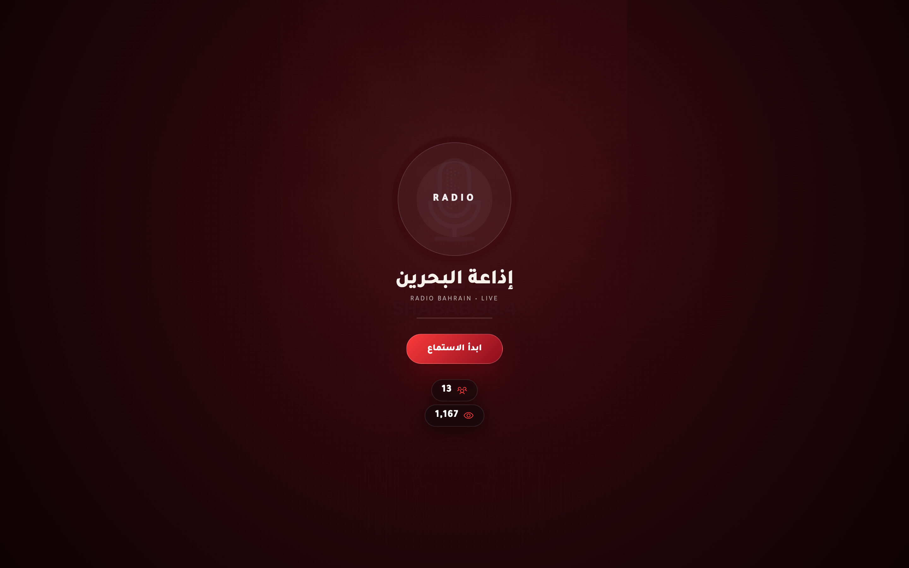 |  |

| Bahrain FM 93.3 (`بحرين FM 93.3`) | Al Shaabiya 95.0 FM (`الشعبية FM 95.0`) |
| :---: | :---: |
| 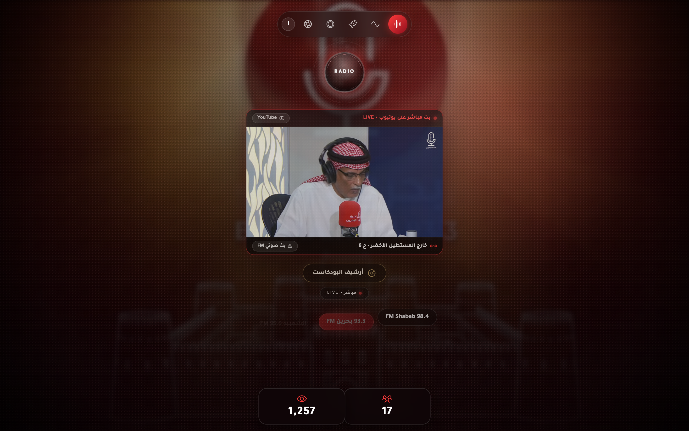 | 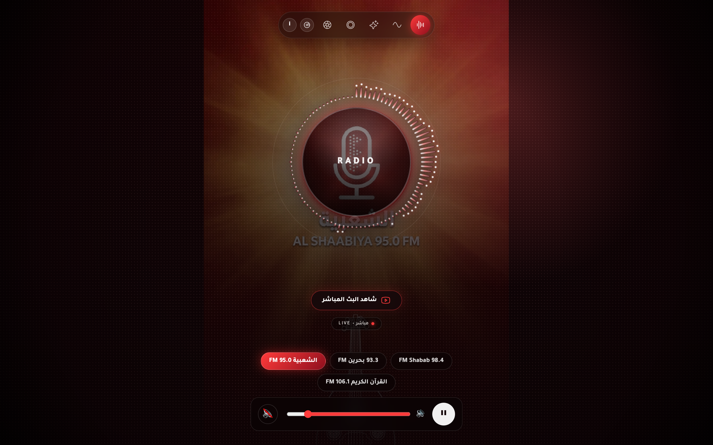 |

| Holy Quran 106.1 FM (`القرآن الكريم FM 106.1`) |
| :---: |
| 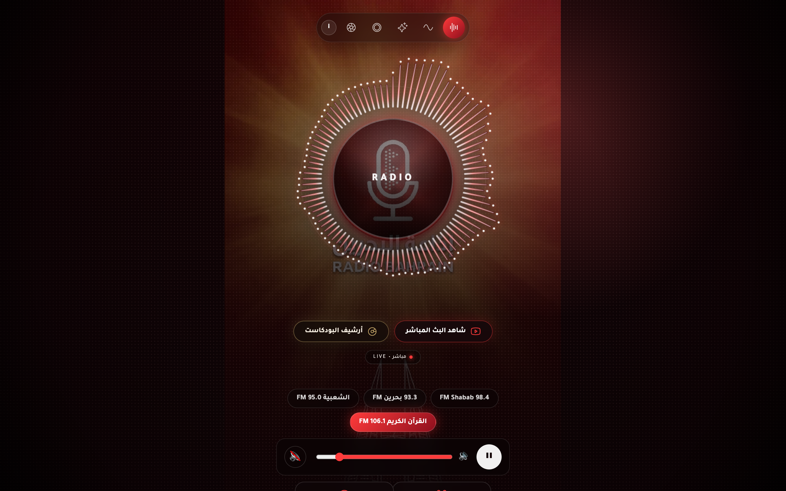 |

---

### 1.2 3D Vinyl Podcasts Archive (`/podcasts`) — Dark & Light Themes

Accessible from the top navigation bar's vinyl disc button (`<a href="/podcasts" class="podcast-btn">`) or directly via `/podcasts` and `/podcasts.html`. The highlighted album features an exclusive dual-layer specular shine and a spinning grooved vinyl record that peeks out to reveal its custom center label and spindle hole:

| 3D Cover-Flow Carousel (Dark Theme `#120204`) | 3D Cover-Flow Carousel (Light Theme `#fdfaf8`) |
| :---: | :---: |
| 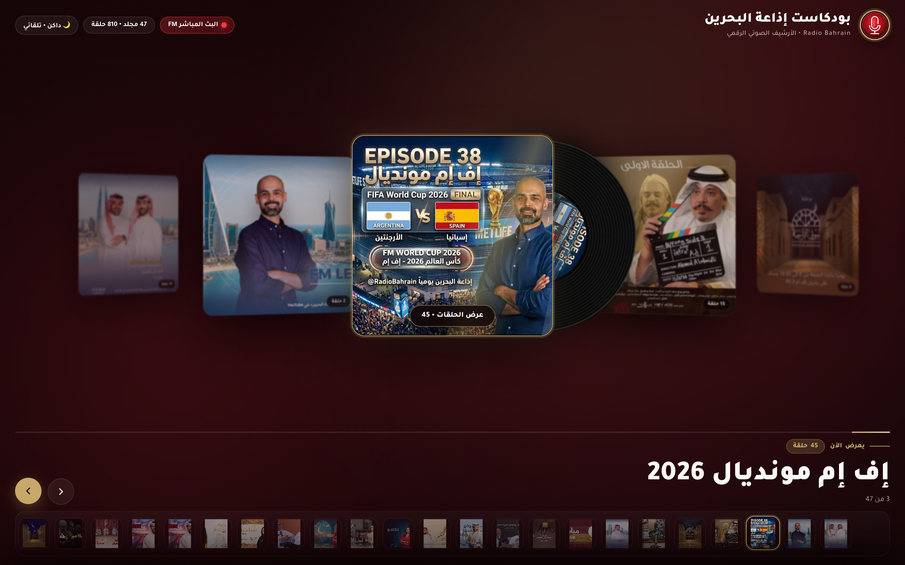 | 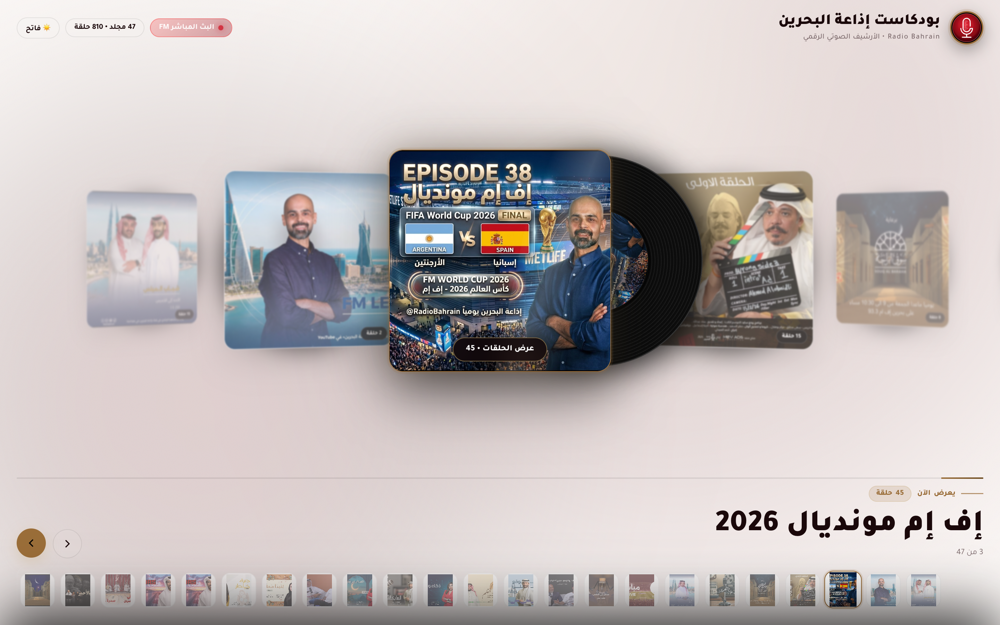 |

| Slide-Up Interactive Episodes Drawer (`#episodesPanel`) |
| :---: |
| 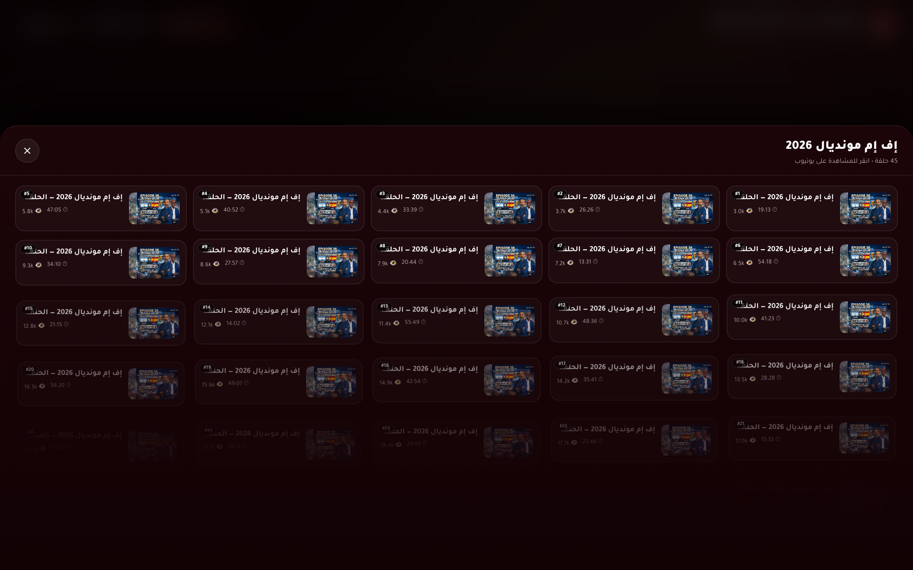 |

---

### 1.3 Mobile Responsive Experience (`393×852` Retina)

Both routes are tailored for mobile screens (`393×852`):
- **Live Player (`/`)**: The station background disc locks within `< 0.05px` of `#btnPower`, while the active listener and visit counters align side-by-side in a horizontal row so the station title (`شباب FM`) remains unobstructed above the YouTube Live button.
- **3D Podcasts Archive (`/podcasts`)**: Features a compact two-row header, a centered `[Album Sleeve + Peeking Vinyl]` composition flanked by neighboring Cover-Flow albums, high-contrast bottom thumbnails, and a full-height mobile episodes drawer.

| Mobile Splash Preloader | Mobile Live Player (`393×852`) |
| :---: | :---: |
| 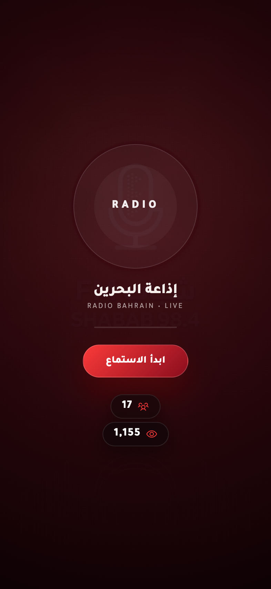 | 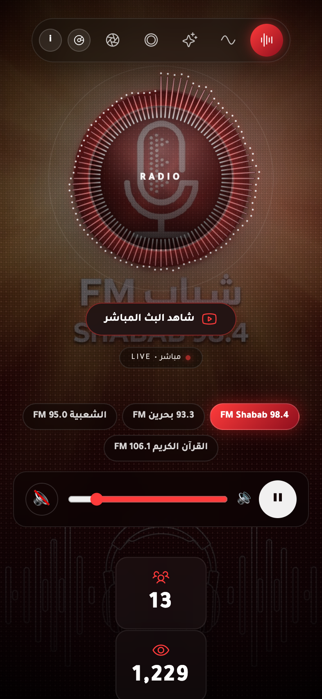 |

| Mobile 3D Cover-Flow & Peeking Vinyl | Mobile Episodes Drawer |
| :---: | :---: |
| 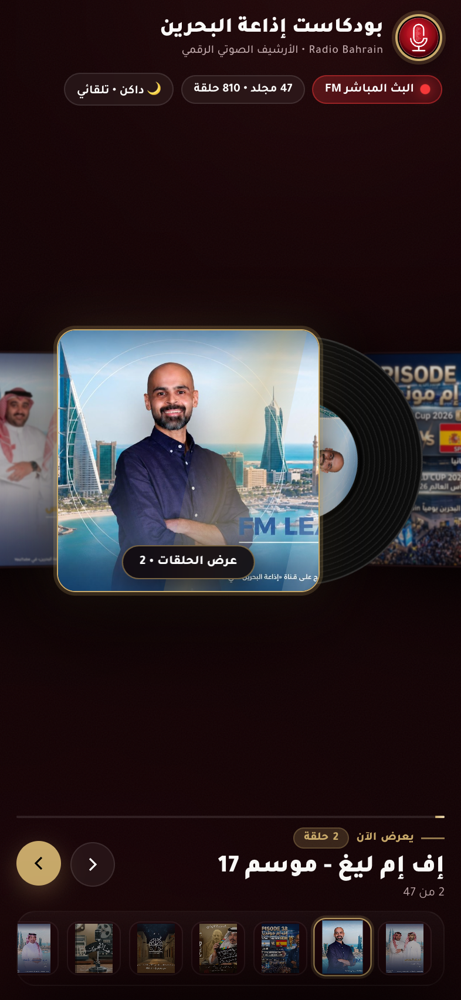 | 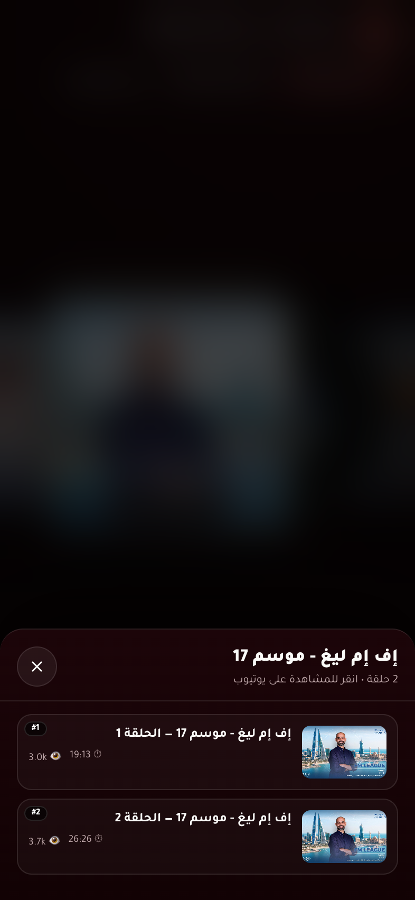 |

---

## 2. System Architecture

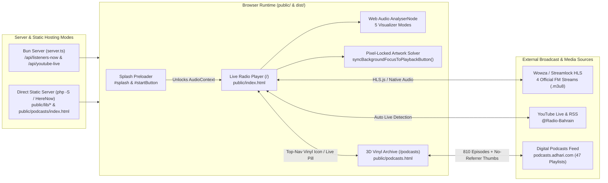

---

## 3. Engineering Highlights & Key Features

### 3.1 Pixel-Locked Station Artwork Solver (`BG_ART`)
Every station background in [`public/assets/`](file:///Users/aldoyh/Sites/RADIOBH/player/public/assets) (`1136×2080`) has a central circular crimson microphone disc baked into the artwork at fractional coordinates:
- Aspect Ratio: `1136 / 2080` (`0.54615`)
- Horizontal Disc Center: `cx = 0.501` (`569.1px`)
- Vertical Disc Center: `cy = 0.417` (`867.4px`)
- Disc Diameter Ratio: `d = 0.195` of image height (`405.6px`)

Standard CSS `background-size: cover` scales the image by viewport width or height, causing the baked-in artwork disc to grow larger than `#btnPower` and drift vertically on mobile screens. Instead, `syncBackgroundFocusToPlaybackButton()` in [`public/index.html`](file:///Users/aldoyh/Sites/RADIOBH/player/public/index.html) measures the live `getBoundingClientRect()` of `#btnPower`, computes the exact image height `imgH = btnDiameter / 0.195` and width `imgW = imgH * (1136 / 2080)`, and pins `--bg-pos` to `(ax - 0.501 * imgW, ay - 0.417 * imgH)`. The background disc remains locked within `< 0.05px` of the foreground `RADIO` button across all desktop and mobile viewports.

### 3.2 5-Mode Web Audio API Spectrum Visualizer
Driven by `AudioContext` + `AnalyserNode` (`fftSize = 256`) at 60fps on dual layered HTML5 canvases (`#canvas-outer` and `#canvas-inner`):
1. **Wave Bars (`bars`)** — 96 radial frequency bars with exponential smoothing and floating peak-hold indicators.
2. **Wave Line (`cline`)** — Continuous dual-ring harmonic contour around the central microphone emblem.
3. **Particles (`particles`)** — Audio-reactive orbital starfield particles whose velocity scales with spectral energy.
4. **Pulse (`pulse`)** — Concentric bass-reactive shockwave rings radiating outward from `#btnPower`.
5. **Nebula (`nebula`)** — Rotating atmospheric multi-stop radial glow modulated by low/mid/high frequency bands.

### 3.3 3D Cover-Flow Vinyl Physics & Active-Only Specular Shine
Implemented in [`public/podcasts.html`](file:///Users/aldoyh/Sites/RADIOBH/player/public/podcasts.html):
- **Active-Only Specular Shine**: `.shine` (`opacity: 0; animation: none`) activates exclusively on `.sleeve.active`, sweeping dual white and gold light beams across the centered album while keeping all 46 inactive albums distraction-free and zero-cost on the GPU.
- **Extended Vinyl Peek (`xPercent: 46` Desktop / `44` Mobile)**: When an album is centered (`Math.abs(offset) < 0.5`), its grooved vinyl record (`95%` diameter) slides out by `46%` of its width on desktop (`~132px` beyond the sleeve edge) and `44%` on mobile (`~87px` beyond the sleeve edge), showcasing the spinning custom center artwork label (`.vLabel`), gold label ring, metallic groove sheen (`conic-gradient`), and center spindle hole.
- **Unobstructed Artwork & Multi-Modal Navigation**: The `عرض الحلقات` button sits cleanly along the bottom edge of the active sleeve so cover portraits are never obscured. Supports mouse wheel scrolling, touch/pointer drag, keyboard arrows (`ArrowLeft`/`ArrowRight`/`Escape`), Prev/Next buttons, and a synchronized bottom thumbnail strip.

### 3.4 Universal Static & Dynamic Server Compatibility
- `gsap.js` and `hls.js` are synced directly into [`public/lib/`](file:///Users/aldoyh/Sites/RADIOBH/player/public/lib) alongside [`public/podcasts/index.html`](file:///Users/aldoyh/Sites/RADIOBH/player/public/podcasts/index.html).
- Whether you run `bun run dev` (`server.ts` at `http://localhost:3000`), run a standalone static server inside `public/` (`php -S localhost:8011 -t ./`), or deploy `dist/` to a static CDN, `/`, `/podcasts`, `/podcasts.html`, `/lib/gsap.js`, and `/lib/hls.js` all resolve with zero configuration.

### 3.5 Brand Favicon & PWA Icon Suite
Generated via [`scripts/generate-favicons.py`](file:///Users/aldoyh/Sites/RADIOBH/player/scripts/generate-favicons.py) (`bun run favicons`) from the official Radio Bahrain circular microphone emblem:

| Asset Path | Format / Dimensions | Purpose |
| :--- | :---: | :--- |
| `public/favicon.svg` | Vector SVG (`512×512` viewBox) | Modern browsers scalable tab icon & header emblem |
| `public/favicon.ico` | Multi-size ICO (`16×16`, `32×32`, `48×48`) | Legacy & standard browser favicon |
| `public/favicon-16x16.png` / `32x32` / `48x48` | PNG (`16×16`, `32×32`, `48×48`) | Standard desktop browser icon sizes |
| `public/apple-touch-icon.png` | PNG (`180×180`) | iOS / iPadOS Home Screen icon |
| `public/android-chrome-192x192.png` / `512x512` | PNG (`192×192`, `512×512`) | Android & PWA installable app icons |
| `public/site.webmanifest` | JSON Web App Manifest | PWA metadata, theme color (`#120204`), and icon links |

---

## 4. Official Radio Bahrain Live Channels

| Station (English) | Station (Arabic) | Frequency | Artwork Asset (`1136×2080`) | HLS Stream Endpoint |
| :--- | :--- | :---: | :--- | :--- |
| **Shabab FM** | شباب FM | `98.4 FM` | `public/assets/shabab-98-4.png` | `https://5c7b683162943.streamlock.net/live/98-4/playlist.m3u8` |
| **Bahrain FM** | بحرين FM | `93.3 FM` | `public/assets/bahrain-93-3.png` | `https://5c7b683162943.streamlock.net/live/ngrp:Bahrain%20FM%2093.3_all/playlist.m3u8` |
| **Al Shaabiya FM** | الشعبية FM | `95.0 FM` | `public/assets/shaabia-95-0.png` | `https://5c7b683162943.streamlock.net/live/ngrp:Traditional%20FM%2095.0_all/playlist.m3u8` |
| **Holy Quran FM** | القرآن الكريم FM | `106.1 FM` | `public/assets/quran-106-1.png` | `https://5c7b683162943.streamlock.net/live/ngrp:Quran%20FM%20106.1_all/playlist.m3u8` |

---

## 5. Quick Start & Local Development

### Option A: Bun Development / Production Server (Recommended)

```bash
# 1. Install dependencies
bun install

# 2. Start local development server with hot-reload on http://localhost:3000
bun run dev

# Or start production server
bun run start
```

- **Live Radio Player**: `http://localhost:3000/`
- **3D Podcasts Archive**: `http://localhost:3000/podcasts`

### Option B: Direct Static HTTP Server from `public/`

```bash
cd public
php -S localhost:8011 -t ./
```

- **Live Radio Player**: `http://localhost:8011/`
- **3D Podcasts Archive**: `http://localhost:8011/podcasts` (or `http://localhost:8011/podcasts.html`)

---

## 6. CLI Scripts & Commands Reference

| Script Command | Underlying Execution | Description |
| :--- | :--- | :--- |
| `bun run dev` | `bun --watch server.ts` | Starts the local Bun server in watch mode on port `3000` (or `$PORT`). |
| `bun run start` | `bun server.ts` | Starts the local Bun server in production mode. |
| `bun run build` | `bun build.ts` | Cleans `dist/`, syncs `gsap.js` & `hls.js` to `public/lib/` and `dist/lib/`, syncs `podcasts/index.html`, embeds `<meta name="version">`, and writes `dist/version.json`. |
| `bun test` / `bun run test:e2e` | `bun test tests/e2e.test.ts` | Runs the 49-assertion Puppeteer E2E visual test suite and refreshes all screenshots in `screenshots/`. |
| `bun run screenshots` | `bun run scripts/capture-screenshots.ts` | Standalone high-DPI (`2x` Retina) screenshot generator for all desktop and mobile views. |
| `bun run favicons` | `python3 scripts/generate-favicons.py` | Regenerates all SVG, ICO, PNG, and Apple Touch icons in `public/`. |
| `bun run deploy:dry` | `bun run scripts/deploy.ts --dry-run` | Validates version bump, `dist/` build, metadata stripping, and `755`/`644` permissions without uploading. |
| `bun run deploy` | `bun run scripts/deploy.ts` | Increments patch version, builds and sanitizes `dist/`, normalizes permissions, and deploys to HereNow. |

---

## 7. Automated End-to-End (E2E) Visual Verification

The E2E test suite in [`tests/e2e.test.ts`](file:///Users/aldoyh/Sites/RADIOBH/player/tests/e2e.test.ts) spawns a local server instance on port `3488` and drives headless Chrome (`puppeteer-core` at `deviceScaleFactor: 2`) through **49 automated assertions**:

1. **Asset, Library & Route Integrity**:
   - Asserts HTTP `200` and valid MIME types for all favicons, `site.webmanifest`, `/lib/gsap.js`, `/lib/hls.js`, `/podcasts`, and `/podcasts.html`.
2. **Desktop Live Player (`1440×900`)**:
   - Captures the splash screen, clicks `#startButton`, waits for `#splash.hidden`, asserts `< 2px` alignment delta between `--bg-focus-x`/`--bg-focus-y` and `#btnPower`, cycles through all 4 FM stations (**Shabab 98.4**, **Bahrain 93.3**, **Al Shaabiya 95.0**, **Holy Quran 106.1**), and saves desktop screenshots.
3. **Mobile Live Player (`393×852`)**:
   - Emulates an iPhone 15 Pro viewport, verifies that the station artwork's intrinsic disc center aligns within `< 2px` of `#btnPower`, and captures mobile splash and hero screenshots.
4. **3D Podcasts Archive (`/podcasts`)**:
   - Verifies playlist hydration (`47` playlists, `810` episodes), Cover-Flow navigation (`#nextBtn`), hotlink-safe thumbnail loading (`naturalWidth > 100`), active-only shine (`activeShineOpacity === "1"`, `inactiveShineOpacity === "0"`), extended vinyl peek (`> 100px` on desktop, `> 70px` and `< 385px` right bound on mobile), Light & Dark themes, and Desktop & Mobile episodes drawers.

```bash
bun test
```

---

## 8. Server API Reference

When running `bun server.ts`, two cached JSON telemetry endpoints are available alongside static file serving:

| Endpoint | Method | Cache TTL | Response Payload |
| :--- | :---: | :---: | :--- |
| `/api/listeners-now` | `GET` | `15s` | `{ activeListeners: number \| null, source: string \| null, updatedAt: string }` |
| `/api/youtube-live` | `GET` | `60s` | `{ isLive: boolean, videoId: string \| null, title?: string, watchUrl: string, checkedAt: string }` |

---

## 9. Automated Deployment Pipeline

[`scripts/deploy.ts`](file:///Users/aldoyh/Sites/RADIOBH/player/scripts/deploy.ts) manages versioning, build sanitization, permission normalization, and publishing:

```bash
# Standard patch release (bumps patch version in package.json and deploys)
bun run deploy

# Minor or major semver release
bun run deploy -- --bump=minor
bun run deploy -- --bump=major

# Explicit version or skip version bump
bun run deploy -- --version=1.7.0
bun run deploy -- --skip-bump

# Safe dry-run verification without uploading
bun run deploy:dry
```

---

## 10. Project Structure

```text
.
├── public/
│   ├── index.html              # Live Radio Player UI, 5-mode Web Audio visualizer & GSAP choreography
│   ├── podcasts.html           # 3D Vinyl Cover-Flow Podcasts Archive (/podcasts.html)
│   ├── podcasts/
│   │   └── index.html          # Directory index for extensionless /podcasts on any static server
│   ├── lib/
│   │   ├── gsap.js             # Local GSAP 3.12 runtime for zero-CDN static serving
│   │   └── hls.js              # Local HLS.js runtime for zero-CDN static serving
│   ├── assets/                 # Official station background artwork (1136×2080)
│   ├── fonts/                  # Self-hosted Tajawal Arabic/Latin font family (5 weights)
│   ├── favicon.svg             # Vector Radio Bahrain microphone emblem
│   ├── favicon.ico             # Multi-resolution ICO (16×16, 32×32, 48×48)
│   ├── apple-touch-icon.png    # iOS Home Screen icon (180×180)
│   ├── android-chrome-*.png    # PWA icons (192×192, 512×512)
│   └── site.webmanifest        # Web App Manifest
├── scripts/
│   ├── capture-screenshots.ts  # Automated 2x Retina screenshot generator
│   ├── generate-favicons.py    # Brand favicon & PWA icon generator
│   └── deploy.ts               # Version bump, sanitization, chmod & HereNow deployment
├── tests/
│   └── e2e.test.ts             # Bun + Puppeteer E2E visual & layout alignment test suite
├── screenshots/                # High-resolution desktop & mobile screenshots generated by E2E
├── docs/
│   └── player-overview.md      # Deep architectural & mathematical documentation
├── server.ts                   # Bun HTTP server (static routes + /api/listeners-now & /api/youtube-live)
├── build.ts                    # Static distribution bundler for dist/
└── package.json                # Project metadata, scripts & dependencies
```

---

## License

Released under the **MIT License**. Crafted with love in Bahrain by **Eng. Hasan AlDoy (م/ حسن الدوي)**.
