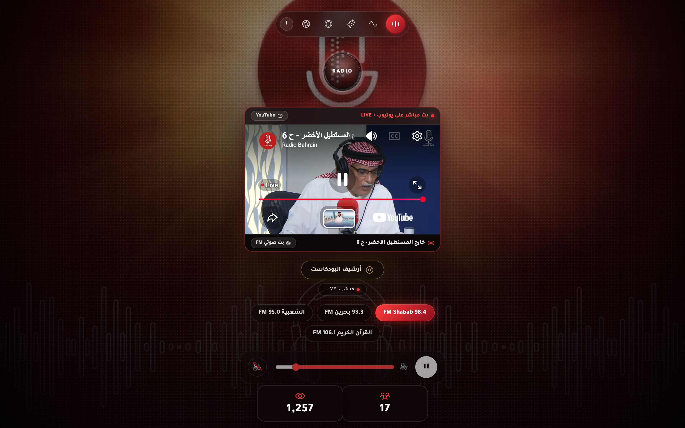
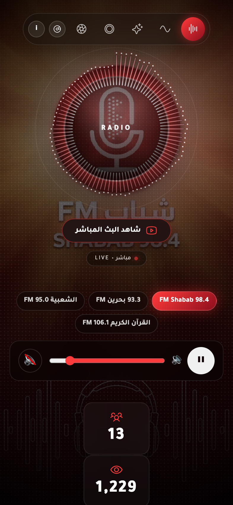
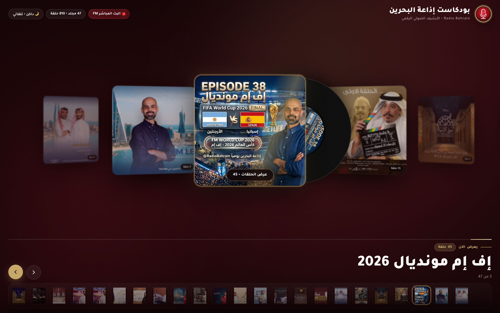
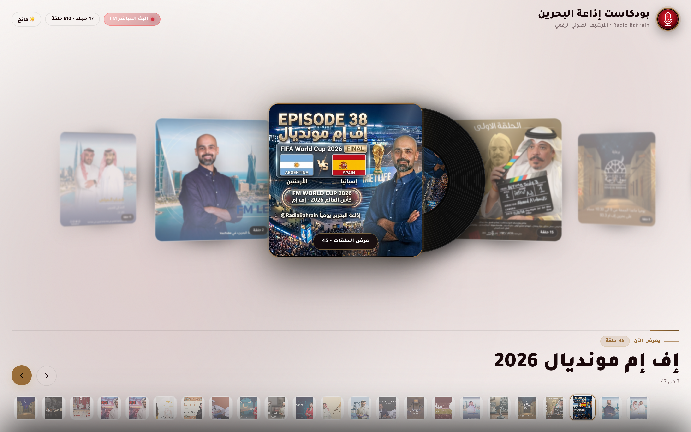
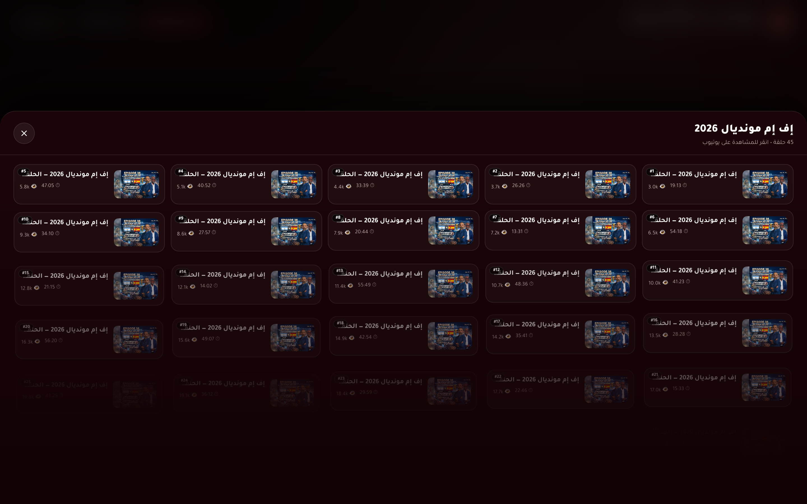
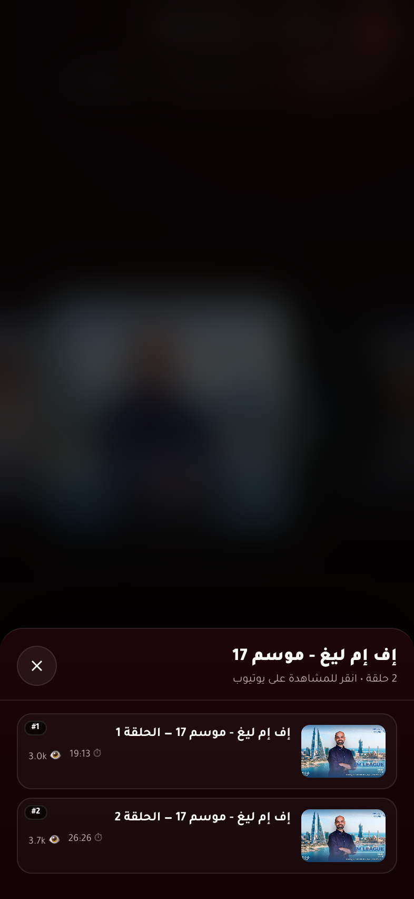

# Radio Bahrain Player — Technical & Architectural Overview

This document details the runtime architecture, mathematical coordinate solver, 3D Cover-Flow physics engine, static/dynamic server compatibility, and automated E2E visual verification suite for the **Radio Bahrain Player** repository.

---

## 1. Runtime & Bundling Architecture

The project is engineered to run identically under both **Bun's dynamic HTTP server** and **any standalone static file server**:

- **Local Development & Production Server ([`server.ts`](../server.ts))**:
  - Serves `public/index.html` at `/`.
  - Serves `public/podcasts.html` (and `public/podcasts/index.html`) at `/podcasts`, `/podcasts/`, and `/podcasts.html`.
  - Exposes `/api/listeners-now` (queries Radio Bahrain's Icecast/Shoutcast endpoints with a 15-second cache) and `/api/youtube-live` (checks `@Radio-Bahrain` live broadcast status with a 60-second cache).
- **Direct Static Serving from `public/` (`php -S`, `python -m http.server`, `serve`)**:
  - `public/lib/gsap.js` and `public/lib/hls.js` are stored directly in `public/lib/`, and `public/podcasts/index.html` provides directory-index resolution for `/podcasts`.
  - Running `php -S localhost:8011 -t ./` inside `public/` serves both `/` and `/podcasts` with zero missing dependencies or rewrite rules required.
- **Static Distribution Bundler ([`build.ts`](../build.ts))**:
  - Cleans `dist/` and copies `public/` (filtering out `.DS_Store`, `Thumbs.db`, `._*`).
  - Syncs `node_modules/gsap/dist/gsap.js` and `node_modules/hls.js/dist/hls.js` into both `public/lib/` and `dist/lib/`.
  - Syncs `public/podcasts/index.html` and `dist/podcasts/index.html`.
  - Embeds `<meta name="version" content="..." />` into `dist/index.html` and emits `dist/version.json`.

---

## 2. Dual-Orientation Responsive Background Alignment (`public/index.html`)

Every station background is provided in two dedicated orientations:
- **Mobile Portrait (`1136×2080`, 9:16)**: Built for smartphones with `BG_ART_PORTRAIT = { aspect: 1136/2080, cx: 0.501, cy: 0.417, d: 0.195 }`.
- **Desktop Widescreen (`1376×768`, 16:9)**: Built for laptops and desktop monitors with `BG_ART_DESKTOP` parameters tuned per station (averaging `aspect: 1376/768, cx: ~0.500, cy: ~0.400, d: ~0.290`), completely eliminating black side voids.

### Full-Bleed Mathematical Placement Solver (`syncBackgroundFocusToPlaybackButton()`)
1. Detects orientation via `window.innerWidth > window.innerHeight` and selects the corresponding background asset (`data-bg-desktop` vs `data-bg`) and `BG_ART` geometry.
2. Measures the live `getBoundingClientRect()` of `#btnPower` (or `#splashLogo` while the splash screen is active) and untransforms the diameter `diameter`.
3. Computes the required image height `h` across all vertical AND horizontal constraints:
   $$\text{h} = \max\left( vh,\; \frac{vw}{\text{aspect}},\; \frac{\text{diameter}}{d},\; \frac{ay}{cy},\; \frac{vh - ay}{1 - cy},\; \frac{ax / cx}{\text{aspect}},\; \frac{(vw - ax) / (1 - cx)}{\text{aspect}} \right)$$
4. Calculates pixel dimensions and offsets so the disc center locks directly onto the button center `(ax, ay)`:
   - `w = h * aspect`
   - `left = ax - cx * w`
   - `top = ay - cy * h`
5. Writes `--bg-size: <w>px <h>px` and `--bg-pos: <left>px <top>px` to `document.documentElement`, automatically re-synchronizing on window resize, device rotation, and GSAP entrance timeline ticks.

| Desktop Alignment (`1440×900`) | Mobile Alignment (`393×852`) |
| :---: | :---: |
|  |  |

---

## 3. 3D Vinyl Podcasts Archive (`public/podcasts.html`)

Accessible at `/podcasts` and `/podcasts.html`, [`public/podcasts.html`](../public/podcasts.html) renders a 60fps 3D Cover-Flow carousel for Radio Bahrain's 47 playlists (810 episodes):

- **60fps Spring Interpolation**:
  - `currentPos += (targetIdx - currentPos) * 0.11` smoothly interpolates toward the selected index and applies 3D perspective transforms (`translate3d`, `rotationY`, `scale`, `blur`) to each `.slide`.
- **Active-Only Specular Shine**:
  - `.shine` is hidden and paused (`opacity: 0; animation: none`) on all inactive sleeves and enabled exclusively on `.sleeve.active`, focusing visual attention on the highlighted album while eliminating background GPU overdraw.
- **Extended Vinyl Peek & Center Label**:
  - `.vinyl` (`top: 2.5%; left: 2.5%; width: 95%; height: 95%`) slides out to `xPercent: 46` on desktop (`~132px` beyond the sleeve edge) and `xPercent: 44` on mobile (`~87px` beyond the sleeve edge) while spinning continuously (`360deg` every `4s`), revealing the custom center label (`.vLabel`), gold ring, metallic groove sheen, and spindle hole.
  - Neighboring right-hand slides shift by `rightClearance` (`56px` desktop / `38px` mobile) so the peeking vinyl is never crowded.
- **Mobile Layout Optimization (`@media (max-width: 768px)`)**:
  - Uses a two-row header (single-line title + horizontal pill bar), shifts the active card by `-36px` so the combined `[Sleeve + Peeking Vinyl]` sits centered in the mobile viewport, and increases bottom thumbnail strip density and contrast.
- **Hotlink-Safe Thumbnail Loading**:
  - Uses `<meta name="referrer" content="no-referrer">` and `referrerpolicy="no-referrer"` so thumbnails hosted on `cloud.adhari.com` load with HTTP `200` from any origin.

| 3D Cover-Flow (Dark Mode) | 3D Cover-Flow (Light Mode) |
| :---: | :---: |
|  |  |

| Desktop Episodes Drawer | Mobile Cover-Flow & Episodes Drawer |
| :---: | :---: |
|  |  |

---

## 4. Favicon & PWA Asset Pipeline (`scripts/generate-favicons.py`)

[`scripts/generate-favicons.py`](../scripts/generate-favicons.py) generates all browser and mobile home-screen icons directly from the official Radio Bahrain circular crimson-and-gold microphone emblem:
- `public/favicon.svg` — scalable vector icon
- `public/favicon.ico` — multi-resolution ICO (`16×16`, `32×32`, `48×48`)
- `public/favicon-16x16.png`, `public/favicon-32x32.png`, `public/favicon-48x48.png`
- `public/apple-touch-icon.png` (`180×180`)
- `public/android-chrome-192x192.png`, `public/android-chrome-512x512.png`
- `public/site.webmanifest`

---

## 5. End-to-End Visual Verification (`tests/e2e.test.ts`)

[`tests/e2e.test.ts`](../tests/e2e.test.ts) runs **50 automated assertions** using `bun:test` and `puppeteer-core`:
1. **Asset, Library & Route Delivery**: Confirms HTTP `200` and expected `Content-Type` headers for all favicons, `site.webmanifest`, `/lib/gsap.js`, `/lib/hls.js`, `/podcasts`, and `/podcasts.html`.
2. **Desktop Live Player Verification (`1440×900`)**: Verifies splash dismissal, asserts `< 2px` background disc alignment, switches across all 4 stations (`Shabab 98.4`, `Bahrain 93.3`, `Shaabia 95.0`, `Holy Quran 106.1`), and captures desktop screenshots.
3. **Mobile Live Player Verification (`393×852`)**: Verifies `< 2px` artwork disc alignment on mobile viewports and captures mobile splash and player screenshots.
4. **3D Podcasts Archive Verification (`/podcasts`)**: Verifies playlist hydration, Cover-Flow navigation, active-only `.shine` opacity, desktop & mobile vinyl peek geometry, Dark & Light themes, and Desktop & Mobile episodes drawers.
