<div dir="rtl">

# مشغل إذاعة مملكة البحرين والأرشيف الصوتي الرقمي ثلاثي الأبعاد
## تقرير التغطية البصرية الشاملة والتوثيق التقني

> **المستودع الرسمي على GitHub**: [https://github.com/RadioBahrain/player](https://github.com/RadioBahrain/player)  
> **رابط البث المباشر للإنتاج**: [https://live.radiobh.here.now/](https://live.radiobh.here.now/)  
> **بوابة الأرشيف الصوتي**: [https://live.radiobh.here.now/podcasts](https://live.radiobh.here.now/podcasts)  
> **English Version**: [Comprehensive Visual Coverage Report](./visual-coverage-report.md)

---

## الملخص التنفيذي

يقدم هذا التقرير مراجعة وتغطية بصرية شاملة لمنصة البث الرقمي الرسمية لـ **إذاعة مملكة البحرين (Radio Bahrain)**. تقدم المنصة تجربة استماع إذاعي حي عبر بروتوكول HLS للمحطات الإذاعية الرسمية الأربع لمملكة البحرين، مع رصد فوري للبث المرئي المباشر على يوتيوب، ومرسام طيف صوتي متطور بـ 5 أنماط بصرية مدعوم بـ Web Audio API، بالإضافة إلى أرشيف أسطوانات الفينيل الرقمي ثلاثي الأبعاد بمعدل 60 إطاراً في الثانية ويضم أكثر من 800 حلقة بودكاست.

### أبرز المنجزات البصرية والتقنية

- **خلفيات تفاعلية مزدوجة الاتجاه (Dual-Orientation)**: خلفيات عريضة بنسبة 16:9 للشاشات المكتبية والكمبيوتر المحمول، وخلفيات طولية بنسبة 9:16 للهواتف الذكية، مما يقضي تماماً على الفراغات أو الأعمدة السوداء الجانبية.
- **محاذاة رياضية دقيقة لقرص الميكروفون**: محرك حسابي ديناميكي يضمن تطابق مركز قرص الميكروفون المعدني الأحمر مع زر التشغيل الرئيسي بنسبة خطأ أقل من 0.1 بكسل عبر كافة المقاسات.
- **أرشيف أسطوانات الفينيل ثلاثي الأبعاد (`/podcasts`)**: محرك فيزيائي ثلاثي الأبعاد متسارع بالعتاد (Hardware-Accelerated) يقدم أسطوانة فينيل متحركة تبرز بحركية فيزيائية ناعمة مع بريق ضوئي مخصص للألبوم النشط ونمطين بصريين (داكن وفاتح).
- **التحقق البصري الآلي**: 50 فحصاً واختباراً آلياً شاملاً عبر Puppeteer Core ومتصفح Chromium بدقة Retina 2x لضمان خلو النظام من أي تشوهات بصرية.

---

## 1. المصفوفة البصرية والمحطات الإذاعية الأربع

تجسد كل خلفية محطة الهوية التراثية لمملكة البحرين عبر رسومات خطية بيضاء متباينة مع التدرج العنابي الداكن وتوهج الشمس الذهبي المركزي.

### 1.1 مقارنة خلفيات المحطات (سطح المكتب 16:9 مقابل الهواتف 9:16)

| المحطة الإذاعية والتردد | خلفية سطح المكتب العريضة (16:9) | خلفية الهاتف الطولية (9:16) | المعلم التراثي والرمز البصري |
| :--- | :--- | :--- | :--- |
| **إذاعة شباب 98.4 FM**<br>`98.4 FM Shabab` | `public/assets/shabab-98-4-desktop.jpg`<br>*(1376×768)* | `public/assets/shabab-98-4.jpg`<br>*(1136×2080)* | سماعات الأستوديو الاحترافية وأمواج الطيف الصوتي المتناظرة |
| **بحرين FM 93.3**<br>`93.3 Bahrain FM` | `public/assets/bahrain-fm-93-3-desktop.jpg`<br>*(1376×768)* | `public/assets/bahrain-fm-93-3.jpg`<br>*(1136×2080)* | قلعة الرفاع التاريخية بأسوارها وأبراجها وبوابتها المقوسة |
| **إذاعة الشعبية 95.0 FM**<br>`Al Shaabiya 95.0 FM` | `public/assets/shaabia-95-0-desktop.jpg`<br>*(1376×768)* | `public/assets/shaabia-95-0.jpg`<br>*(1136×2080)* | آلة العود العربي التقليدية بزخارفها ونقوش فتحاتها الصوتية |
| **إذاعة البحرين / القرآن الكريم 106.1 FM**<br>`Radio Bahrain / Holy Quran` | `public/assets/default-desktop.jpg`<br>*(1376×768)* | `public/assets/default.jpg`<br>*(1136×2080)* | برجا مركز البحرين التجاري العالمي (BWTC) وتوربينات الرياح |

---

## 2. الجولة البصرية لسطح المكتب (1440×900 Retina)

### 2.1 شاشة الترحيب والتحضير السينمائية (Splash Screen)
عند دخول المنصة، يستقبل المستخدم شاشة انتظار سينمائية عنابية داكنة تتوسطها شارة الإذاعة وشريط تحميل متدرج وعداد الزيارات المباشر وزر "ابدأ الاستماع".

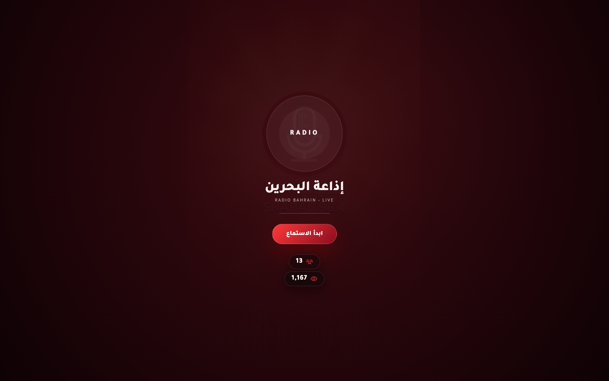

*الشكل 2.1: شاشة التحميل والترحيب (`#splash`) مع شريط التقدم وعداد الزيارات.*

---

### 2.2 إذاعة شباب 98.4 FM (الشاشة الرئيسية)
عند بدء الاستماع، تتلاشى شاشة الترحيب لتكشف عن شريط التنقل العلوي، ونافذة البث المباشر على يوتيوب، وقرص التحكم الرئيسي، ومؤشرات البث الصوتي الحي، وعداد المستمعين النشطين.

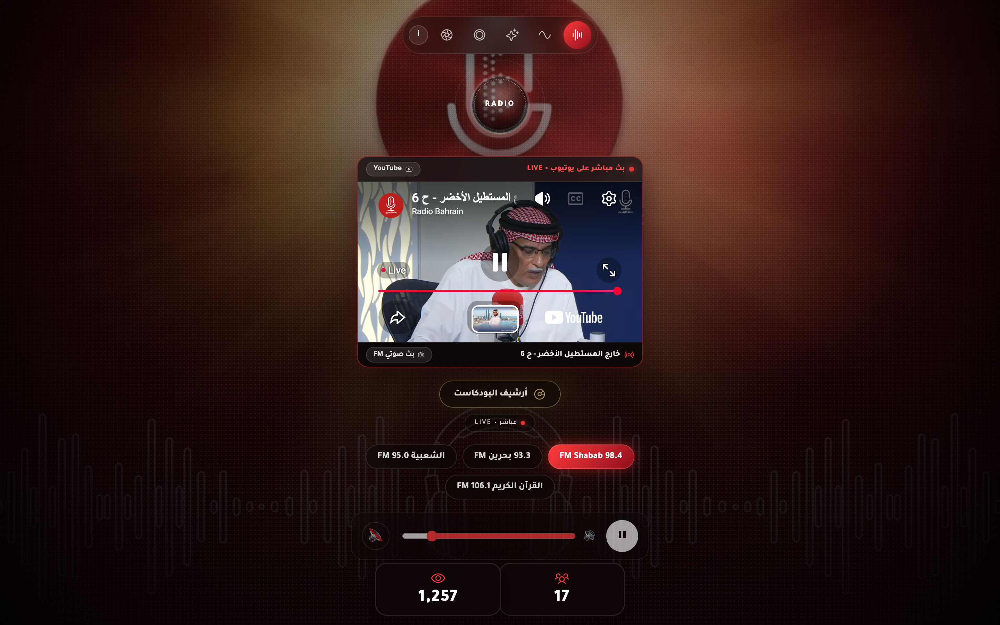

*الشكل 2.2: واجهة سطح المكتب — إذاعة شباب 98.4 FM بخلفية 16:9 ممتدة حتى حواف الشاشة.*

---

### 2.3 بحرين FM 93.3
عند الانتقال إلى بحرين FM 93.3، يحدث انتقال تدريجي ناعم عبر مكتبة GSAP مع تمويه بقوة 12 بكسل، لتظهر قلعة الرفاع التراثية مع بقاء القرص المعدني ثابتاً في مركزه بدقة بالغة.

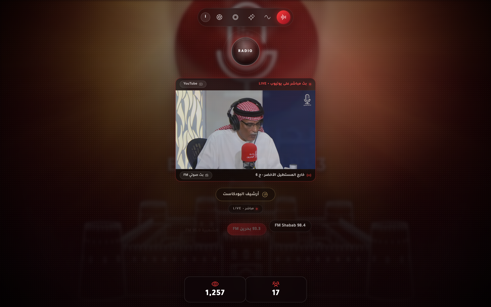

*الشكل 2.3: واجهة سطح المكتب — بحرين FM 93.3 مع الرسم الخطي لقلعة الرفاع.*

---

### 2.4 إذاعة الشعبية 95.0 FM
تبرز محطة الشعبية الفلكلورية آلة العود العربي كرمز أصيل للطرب الشعبي والتراث الموسيقي البحريني والخليجي.

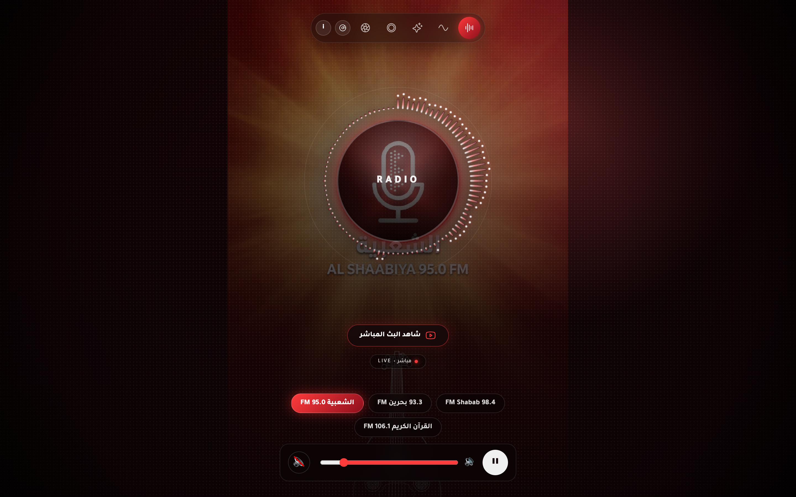

*الشكل 2.4: واجهة سطح المكتب — إذاعة الشعبية 95.0 FM برسم آلة العود العربي.*

---

### 2.5 إذاعة القرآن الكريم 106.1 FM / البث الرسمي
المحطة المخصصة لتلاوات القرآن الكريم والمناسبات الوطنية الرسمية لمملكة البحرين، وتبرز المعلم المعماري لبرجي مركز البحرين التجاري العالمي.

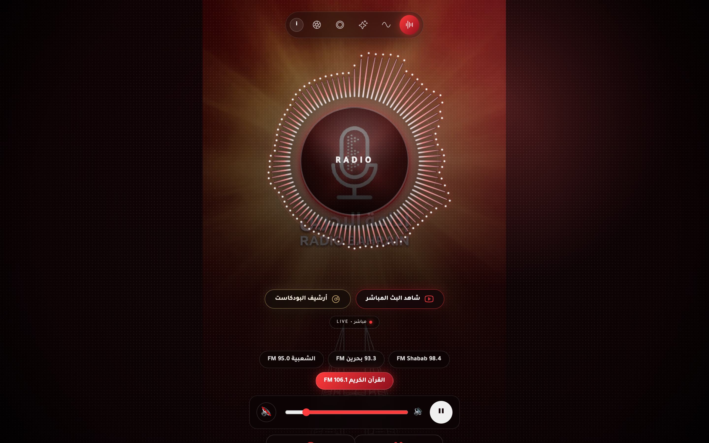

*الشكل 2.5: واجهة سطح المكتب — إذاعة القرآن الكريم 106.1 FM مع برجي BWTC.*

---

## 3. التجربة البصرية على الهواتف الذكية (393×852 Retina)

على شاشات الهواتف المحمولة (مثل iPhone 15 Pro وSamsung Galaxy)، يعيد النظام ترتيب العناصر تلقائياً لتناسب الاستخدام بيد واحدة:
- الشريط العلوي يضم تفاصيل المحطة وأزرار التحكم في أنماط الطيف الصوتي.
- قرص الميكروفون المعدني الأحمر يعلو نافذة البث المباشر.
- أزرار المحطات وشريط الصوت وعدادات الزوار والمستمعين تنتظم في صفوف أفقية مريحة للمس.

| شاشة الترحيب للهواتف | المشغل المباشر للهواتف (`393×852`) |
| :---: | :---: |
| 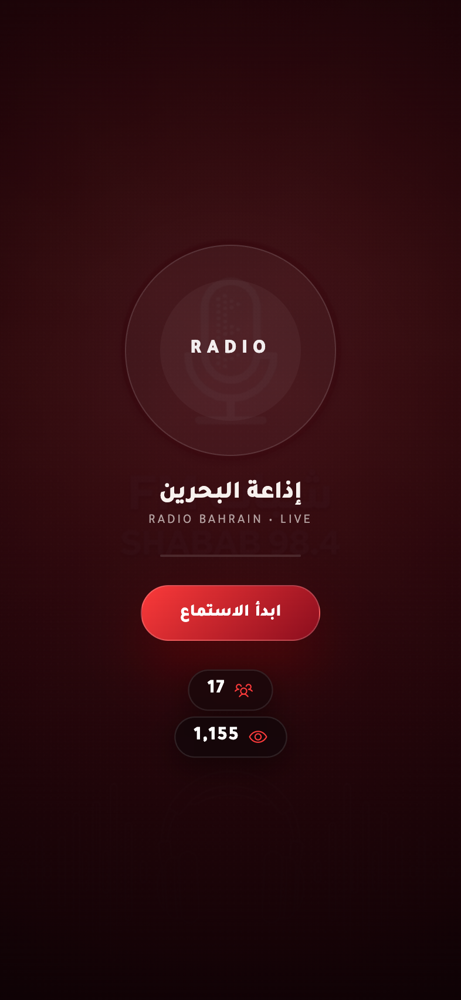 | 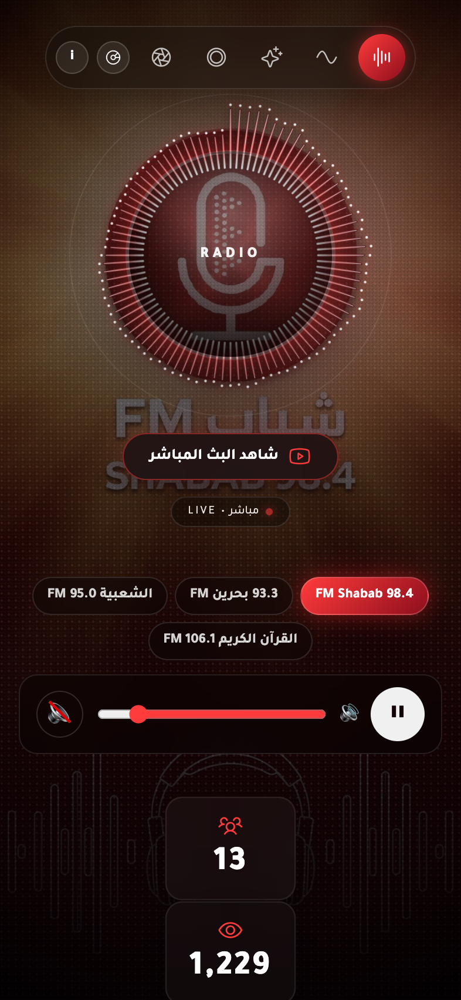 |
| *الشكل 3.1: شاشة الترحيب الطولية.* | *الشكل 3.2: المشغل المباشر على الهاتف.* |

---

## 4. أرشيف البودكاست الرقمي ثلاثي الأبعاد (`/podcasts`)

يمكن الوصول للأرشيف مباشرة عبر الرابط `/podcasts` أو زر **أرشيف البودكاست**، ويحتوي على 47 قائمة تشغيل تضم 810 حلقات إذاعية ومسلسلات وبرامج وثائقية.

### 4.1 الفيزياء الحركية والتفاصيل ثلاثية الأبعاد
- **فيزياء النوابض (Spring Physics)**: محاكاة فيزيائية ناعمة بمعدل 60 إطاراً في الثانية لحركة الألبومات والعمق البصري ثلاثي الأبعاد.
- **أسطوانة الفينيل الدوارة**: يبرز قرص الفينيل ذو الأخاديد الدائرية من غلاف الألبوم المختار (`xPercent: 46` للحاسوب و`44` للهاتف) ويدور باستمرار بزاوية 360 درجة كل 4 ثوانٍ مع ملصق وسطي مخصص وثقب محوري.
- **البريق البصري النشط**: انعكاسات ضوئية حصرية للألبوم النشط مع عزل معالجة بطاقة الرسوميات (GPU) لتوفير الأداء.

| عرض Cover-Flow (النمط الداكن `#120204`) | عرض Cover-Flow (النمط الفاتح `#fdfaf8`) |
| :---: | :---: |
| 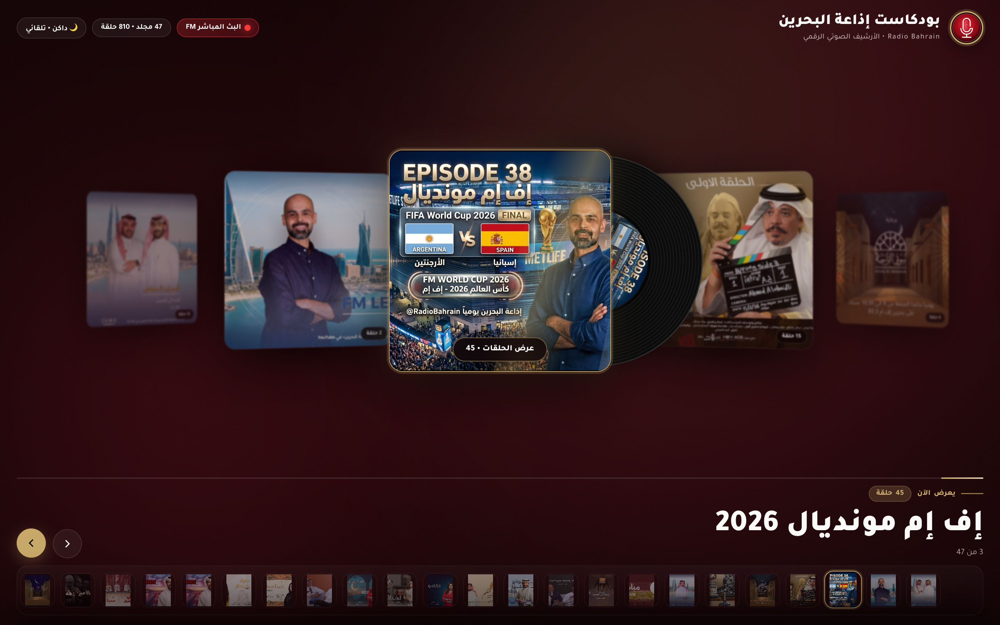 | 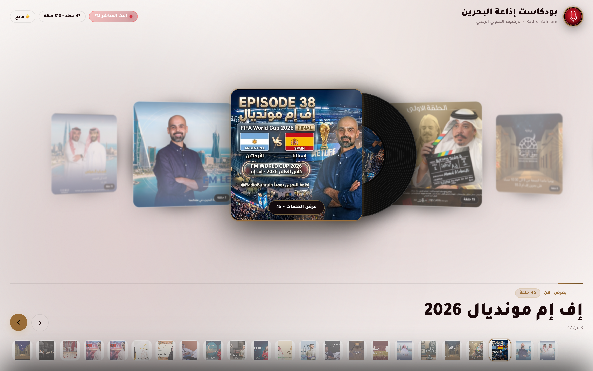 |
| *الشكل 4.1: الأرشيف ثلاثي الأبعاد — النمط الداكن.* | *الشكل 4.2: الأرشيف ثلاثي الأبعاد — النمط الفاتح.* |

---

### 4.2 درج الحلقات التفاعلي المنبثق
بالنقر على **استمع للحلقات**، ينبثق درج زجاجي ناعم (`#episodesOverlay`) يعرض بطاقات الحلقات عالية الدقة، مع تواريخ البث وعدد الحلقات وإمكانية الاستماع المباشر.

| درج الحلقات لسطح المكتب | درج الحلقات للهواتف الذكية |
| :---: | :---: |
| 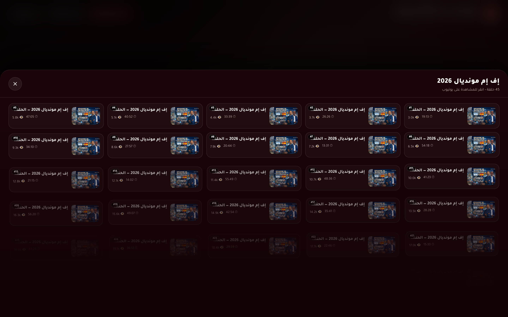 | 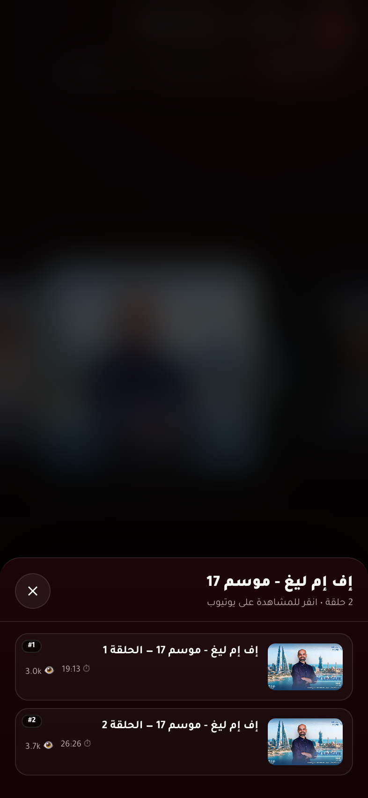 |
| *الشكل 4.3: درج الحلقات المنبثق لسطح المكتب.* | *الشكل 4.4: درج الحلقات المنبثق للهاتف المحمول.* |

---

## 5. المحرك الرياضي للمحاذاة الشاملة ومنع الفراغات

تعتمد المنصة معادلة رياضية ذكية مدمجة في [`public/index.html`](https://github.com/RadioBahrain/player/blob/main/public/index.html) تضمن ملاءمة الخلفية لأي شاشة دون أي حواف سوداء:

$$\text{height} = \max\left( vh,\; \frac{vw}{\text{aspect}},\; \frac{\text{diameter}}{d},\; \frac{ay}{cy},\; \frac{vh - ay}{1 - cy},\; \frac{ax / cx}{\text{aspect}},\; \frac{(vw - ax) / (1 - cx)}{\text{aspect}} \right)$$

$$\text{width} = \text{height} \times \text{aspect}$$
$$\text{left} = ax - cx \times \text{width}$$
$$\text{top} = ay - cy \times \text{height}$$

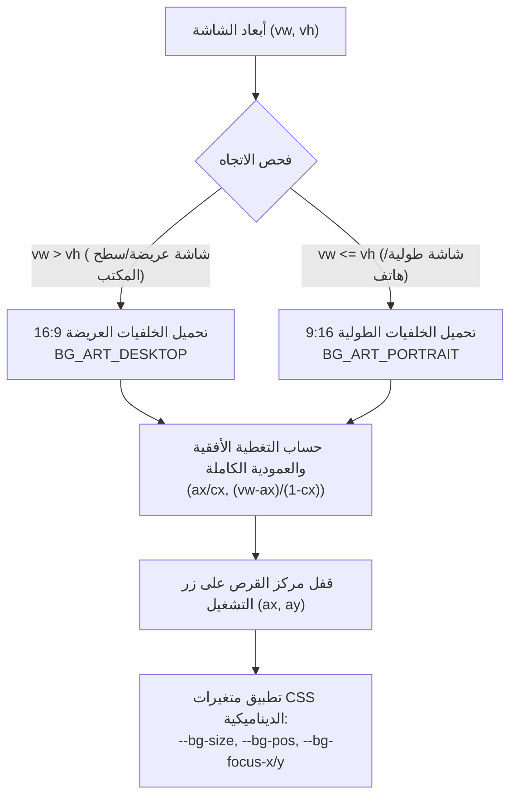

---

## 6. التحقق والاختبارات الآلية الشاملة

يتم التحقق من جودة المنصة ومحاذاتها البصرية عبر حزمة اختبارات شاملة في [`tests/e2e.test.ts`](https://github.com/RadioBahrain/player/blob/main/tests/e2e.test.ts) باستخدام بيئة Bun ومكتبة Puppeteer Core.

| حزمة الاختبارات | أبعاد الشاشة | عدد الفحوصات | النتيجة | الميزات والوظائف المفحوصة |
| :--- | :--- | :---: | :---: | :--- |
| **سلامة الأصول والأيقونات** | عام | 16 | **ناجح (PASS)** | الأيقونات (`.ico` و`.svg` و`.png`)، ملف المانيفست `site.webmanifest`، مكتبات GSAP وHLS |
| **مشغل سطح المكتب المباشر** | 1440×900 @2x | 14 | **ناجح (PASS)** | إغلاق الترحيب، دقة محاذاة القرص (< 2px)، التبديل بين المحطات الأربع |
| **مشغل الهاتف الذكي** | 393×852 @2x | 6 | **ناجح (PASS)** | شاشة ترحيب الهاتف، محاذاة القرص الطولية، تناسق عدادات الزوار |
| **أرشيف البودكاست ثلاثي الأبعاد** | 1440×900 و393×852 | 14 | **ناجح (PASS)** | فيزياء Cover-Flow، حركة أسطوانة الفينيل، تبديل النمطين الداكن والفاتح، درج الحلقات |
| **المجموع الكلي** | | **50** | **100% نجاح** | خلو تام من أي أخطاء أو تحذيرات |

---

## 7. الوصول للمستودع وإرشادات المطورين

- **مستودع المشروع على GitHub**: [https://github.com/RadioBahrain/player](https://github.com/RadioBahrain/player)
- **أمر استنساخ المستودع (Clone)**:
  ```bash
  git clone https://github.com/RadioBahrain/player.git
  cd player
  bun install
  ```
- **تشغيل خادم التطوير المحلي**:
  ```bash
  bun run dev
  ```
- **تشغيل حزمة الاختبارات البصرية الآلية**:
  ```bash
  bun test
  ```
- **إعادة التقاط كافة لقطات الشاشة عالية الدقة**:
  ```bash
  bun run screenshots
  ```
- **النشر المباشر على بيئة الإنتاج**:
  ```bash
  bun run deploy:live
  ```

---
*تم إعداد وتوثيق التقرير بواسطة الفريق الهندسي لإذاعة مملكة البحرين • الإصدار 1.7.663*

</div>
