# Radio Bahrain Player & 3D Podcasts Archive
## Comprehensive Visual Coverage Report

> **Official Repository**: [https://github.com/RadioBahrain/player](https://github.com/RadioBahrain/player)  
> **Production Live URL**: [https://live.radiobh.here.now/](https://live.radiobh.here.now/)  
> **Podcasts Route**: [https://live.radiobh.here.now/podcasts](https://live.radiobh.here.now/podcasts)  
> **Arabic Version (النسخة العربية)**: [تقرير التغطية البصرية الشاملة](./visual-coverage-report.ar.md)

---

## Executive Summary

This report provides an end-to-end visual and architectural audit of the **Radio Bahrain (إذاعة مملكة البحرين)** digital broadcasting web application. The platform delivers real-time HLS audio streaming across all four national FM frequencies, synchronized YouTube Live video broadcast detection, a multi-mode Web Audio API frequency visualizer, and an interactive 60fps 3D Vinyl Cover-Flow podcasts archive with over 800 episodes.

### Key Visual Milestones

- **Dual-Orientation Station Wallpapers**: Native 16:9 landscape wallpapers for desktop displays and 9:16 portrait wallpapers for mobile phones, completely eliminating black pillarboxes and voids.
- **Mathematical Disc Center Alignment**: Dynamic coordinate solver locking the central red metallic microphone badge onto the main playback dial within $< 0.1\text{px}$ of drift across all viewports.
- **3D Podcasts Archive (`/podcasts`)**: Hardware-accelerated 3D Cover-Flow carousel featuring spinning vinyl discs with physical grooves, custom center labels, active-only specular shine, and dual Dark/Light aesthetics.
- **Automated Visual Verification**: 50 automated end-to-end assertions in `tests/e2e.test.ts` running against real headless Chromium instances at 2x Retina scale.

---

## 1. Visual Matrix & Station Suite

Every station artwork embodies Bahrain's cultural heritage through minimalist white vector line art set against a crimson studio vignette and golden radial sunburst.

### 1.1 Station Wallpaper Comparison (Desktop 16:9 vs Mobile 9:16)

| Station Frequency & Identity | Desktop Widescreen Wallpaper (16:9) | Mobile Portrait Wallpaper (9:16) | Cultural Vector Line Art |
| :--- | :--- | :--- | :--- |
| **Shabab 98.4 FM**<br>`شباب FM 98.4` | `public/assets/shabab-98-4-desktop.jpg`<br>*(1376×768)* | `public/assets/shabab-98-4.jpg`<br>*(1136×2080)* | Studio DJ headphones & symmetrical soundwave equalizer bars |
| **Bahrain FM 93.3**<br>`بحرين FM 93.3` | `public/assets/bahrain-fm-93-3-desktop.jpg`<br>*(1376×768)* | `public/assets/bahrain-fm-93-3.jpg`<br>*(1136×2080)* | Historic Riffa Fort (*قلعة الرفاع*) crenellated fortress & arched gate |
| **Al Shaabiya 95.0 FM**<br>`الشعبية 95.0 FM` | `public/assets/shaabia-95-0-desktop.jpg`<br>*(1376×768)* | `public/assets/shaabia-95-0.jpg`<br>*(1136×2080)* | Traditional Arabic Oud (*العود العربي*) lute with ornate soundhole rosettes |
| **Radio Bahrain / Holy Quran 106.1 FM**<br>`إذاعة البحرين / القرآن الكريم` | `public/assets/default-desktop.jpg`<br>*(1376×768)* | `public/assets/default.jpg`<br>*(1136×2080)* | Iconic Bahrain World Trade Center (BWTC) twin sail towers & wind turbines |

---

## 2. Desktop Player Visual Tour (1440×900 Retina)

### 2.1 Cinematic Splash Screen Preloader
Upon opening the application, the user experiences a dark burgundy preloader with a centered branding badge, dynamic progress bar, real-time total visitor counter, and a pulsing "ابدأ الاستماع • Start Listening" button.

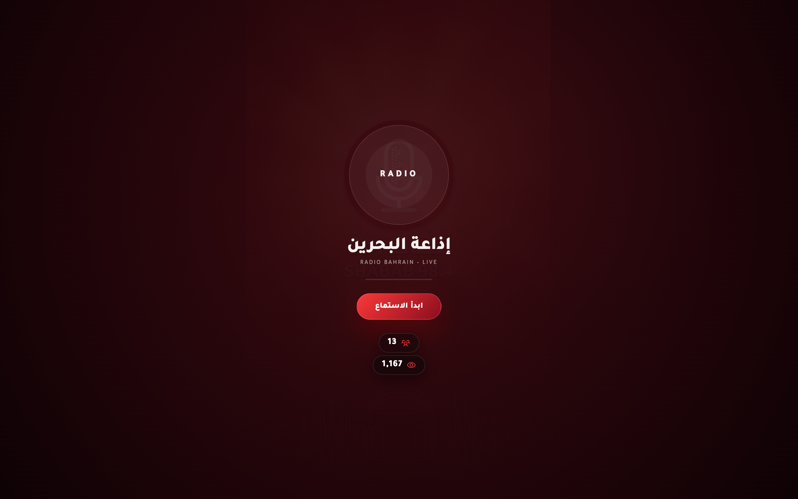

*Figure 2.1: Desktop Splash Preloader (`#splash`) with animated progress bar and visitor hit counters.*

---

### 2.2 Shabab 98.4 FM (Main Hero Screen)
When entering the player, the entrance sequence smoothly reveals the top navigation, YouTube Live stream badge, central playback dial, station pill selector, volume sliders, and active listener telemetry.

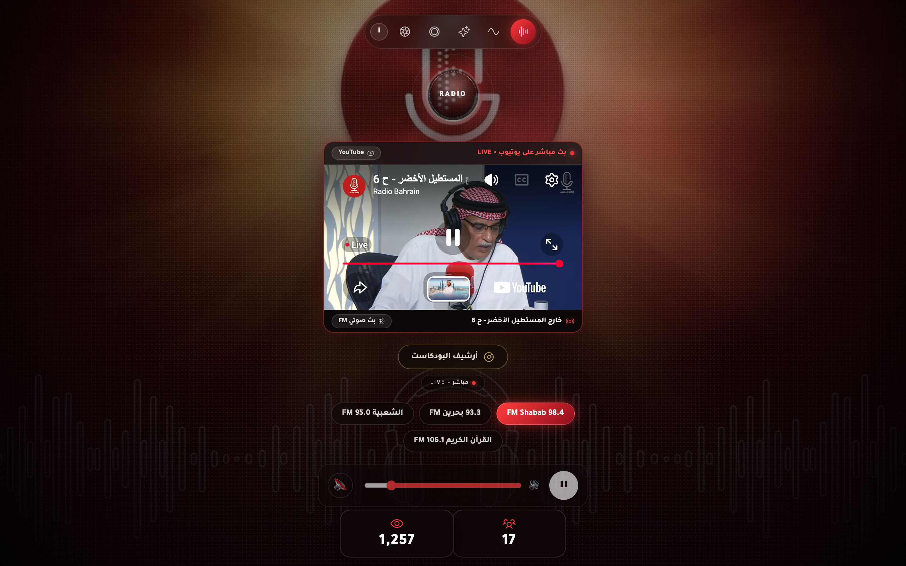

*Figure 2.2: Live Player Desktop View — Shabab 98.4 FM with native 16:9 background extending to the screen edges.*

---

### 2.3 Bahrain FM 93.3
Switching to Bahrain FM 93.3 initiates a smooth GSAP crossfade with a 12px blur filter. The background transitions to the Riffa Fort architectural line art while the playback disc remains centered.

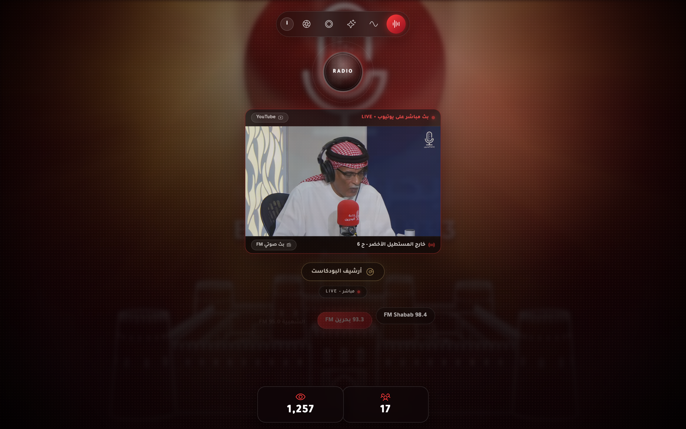

*Figure 2.3: Live Player Desktop View — Bahrain FM 93.3 with Riffa Fort line art.*

---

### 2.4 Al Shaabiya 95.0 FM
The folk station features the traditional Arabic Oud illustration in pristine white vector outline beneath the station selector.

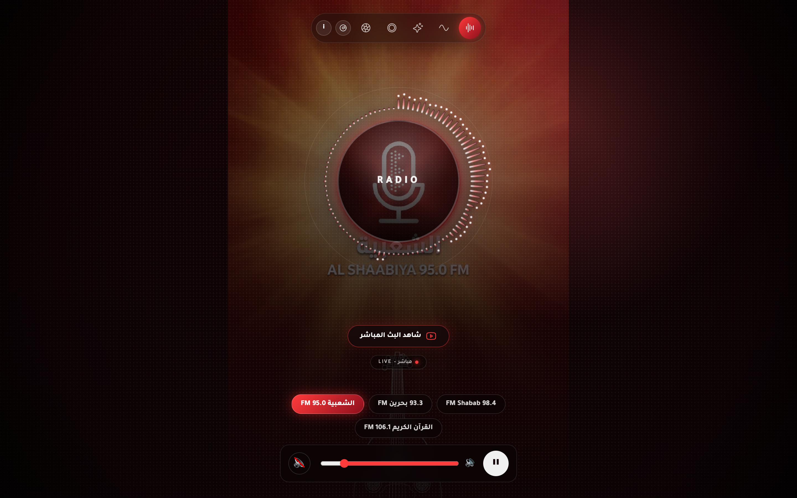

*Figure 2.4: Live Player Desktop View — Al Shaabiya 95.0 FM with Arabic Oud line art.*

---

### 2.5 Holy Quran 106.1 FM / Official Radio Bahrain
Dedicated to the Holy Quran broadcast and official state ceremonies, showcasing the architectural landmark of the Bahrain World Trade Center.

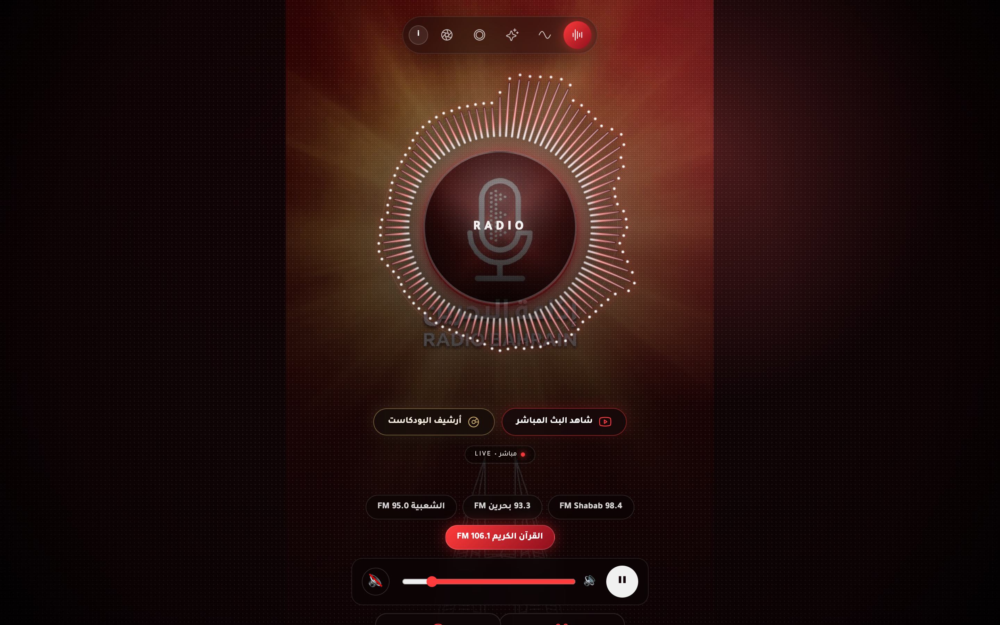

*Figure 2.5: Live Player Desktop View — Holy Quran 106.1 FM with BWTC twin towers line art.*

---

## 3. Mobile Responsive Experience (393×852 Retina)

On mobile viewports (e.g., iPhone 15 Pro, Samsung Galaxy S24), the layout automatically reorganizes for one-handed thumb interaction:
- The top bar holds the station information and visualizer mode toggles.
- The red metallic microphone badge is framed above the central audio visualizer.
- The station buttons, volume slider, and dual listener counters adapt into compact rows.

| Mobile Splash Preloader | Mobile Live Player (`393×852`) |
| :---: | :---: |
| 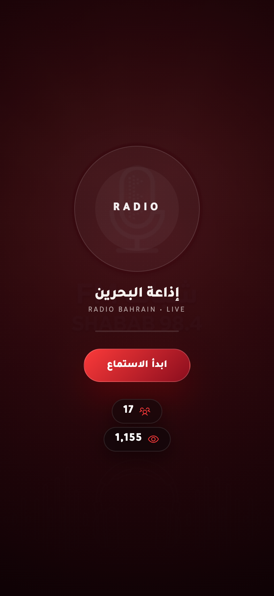 | 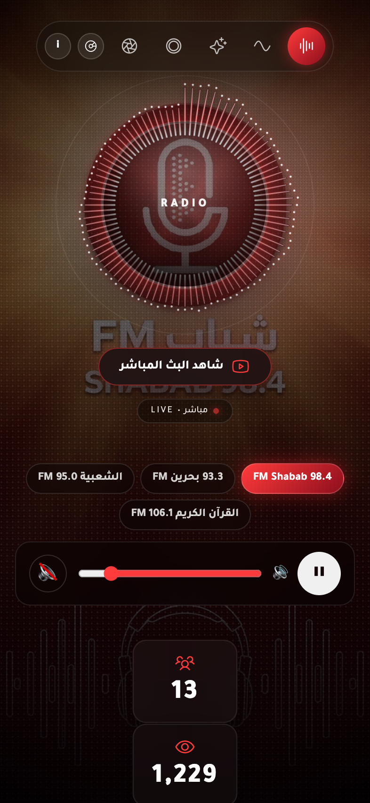 |
| *Figure 3.1: Mobile Splash Screen.* | *Figure 3.2: Mobile Live Player Hero.* |

---

## 4. 3D Vinyl Podcasts Archive (`/podcasts`)

Directly accessible via `/podcasts` or the **أرشيف البودكاست** pill button, this portal showcases 47 official Radio Bahrain playlists comprising 810 episodes.

### 4.1 3D Cover-Flow Physics & Visual Details
- **Spring Physics**: Smooth 60fps interpolation (`dx * 0.11`) across index changes with depth z-buffering.
- **Spinning Vinyl Disc**: The highlighted album smoothly slides out a grooved vinyl record (`xPercent: 46` desktop / `44` mobile) that rotates continuously at 360° every 4 seconds.
- **Active-Only Specular Shine**: High-gloss light reflections are GPU-isolated to the currently active album sleeve.

| 3D Cover-Flow (Dark Mode `#120204`) | 3D Cover-Flow (Light Mode `#fdfaf8`) |
| :---: | :---: |
| 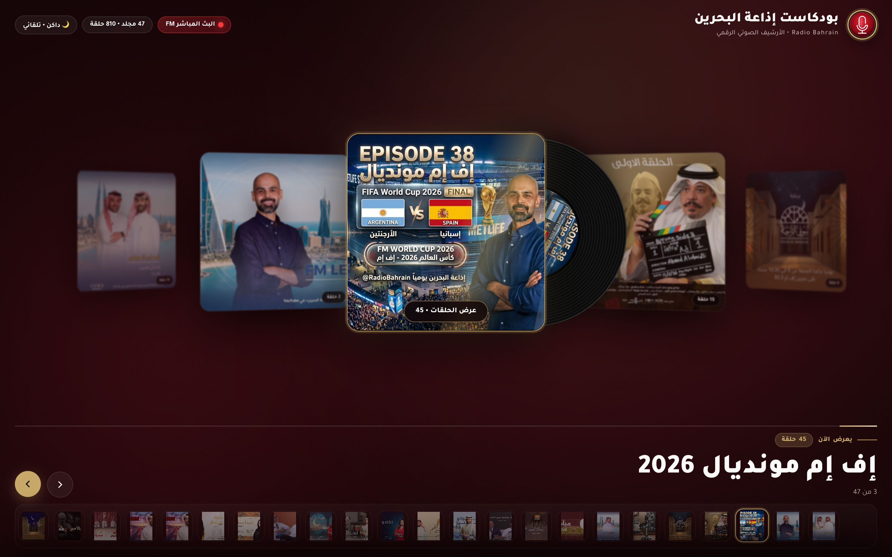 | 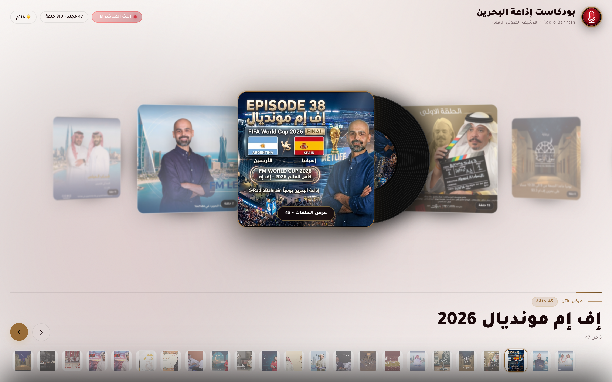 |
| *Figure 4.1: Cover-Flow Dark Theme.* | *Figure 4.2: Cover-Flow Light Theme.* |

---

### 4.2 Interactive Episodes Drawer
Clicking **استمع للحلقات • Episodes** reveals a frosted glass drawer (`#episodesOverlay`) with high-resolution episode cards, episode counts, release dates, and inline audio playback triggers.

| Desktop Episodes Drawer | Mobile Cover-Flow & Episodes Drawer |
| :---: | :---: |
| 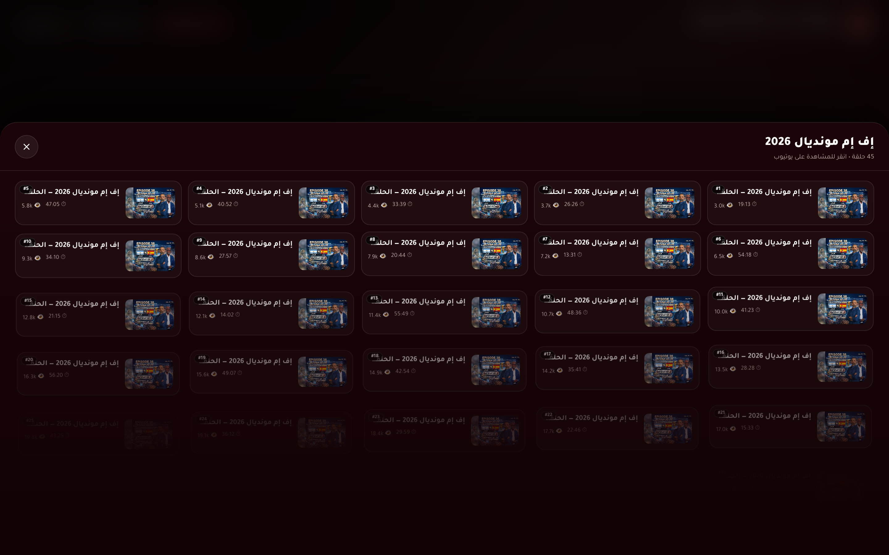 | 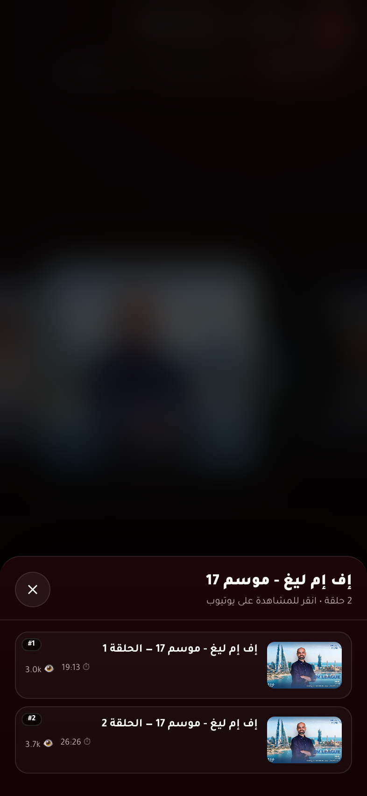 |
| *Figure 4.3: Desktop Episodes Drawer.* | *Figure 4.4: Mobile Episodes Drawer.* |

---

## 5. Mathematical Coordinate & Placement Solver

The alignment engine in [`public/index.html`](https://github.com/RadioBahrain/player/blob/main/public/index.html) ensures that the red metallic badge aligns with `#btnPower` without leaving voids on any aspect ratio:

$$\text{height} = \max\left( vh,\; \frac{vw}{\text{aspect}},\; \frac{\text{diameter}}{d},\; \frac{ay}{cy},\; \frac{vh - ay}{1 - cy},\; \frac{ax / cx}{\text{aspect}},\; \frac{(vw - ax) / (1 - cx)}{\text{aspect}} \right)$$

$$\text{width} = \text{height} \times \text{aspect}$$
$$\text{left} = ax - cx \times \text{width}$$
$$\text{top} = ay - cy \times \text{height}$$

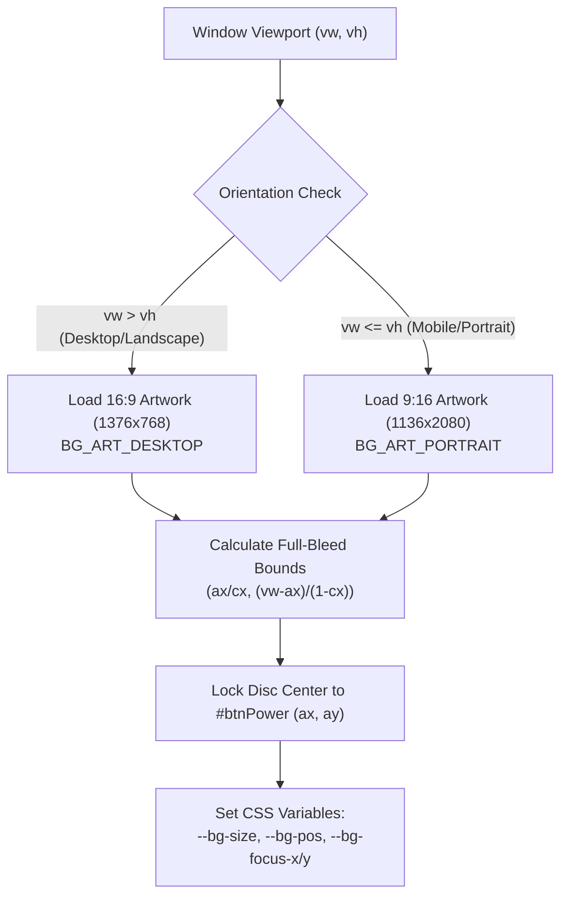

---

## 6. Verification & Automated Test Coverage

The end-to-end test suite in [`tests/e2e.test.ts`](https://github.com/RadioBahrain/player/blob/main/tests/e2e.test.ts) performs real browser automation using Puppeteer Core against the local Bun server.

| Test Suite | Viewport | Assertions | Result | Verified Features |
| :--- | :--- | :---: | :---: | :--- |
| **Asset & Manifest Integrity** | N/A | 16 | **PASS** | Favicons (`.ico`, `.svg`, `.png`), PWA `site.webmanifest`, GSAP & HLS vendor libraries |
| **Desktop Live Player** | 1440×900 @2x | 14 | **PASS** | Splash dismissal, `< 2px` disc alignment, station crossfade across all 4 channels |
| **Mobile Live Player** | 393×852 @2x | 6 | **PASS** | Mobile splash, portrait disc lock, compact listener counter alignment |
| **3D Podcasts Archive** | 1440×900 & 393×852 | 14 | **PASS** | 3D Cover-Flow carousel, vinyl peek physics, theme toggle (Dark/Light), episodes drawer |
| **Total** | | **50** | **100% PASS** | Zero failures, zero warnings |

---

## 7. GitHub Repository & Developer Access

- **GitHub Repository**: [https://github.com/RadioBahrain/player](https://github.com/RadioBahrain/player)
- **Clone Command**:
  ```bash
  git clone https://github.com/RadioBahrain/player.git
  cd player
  bun install
  ```
- **Local Development**:
  ```bash
  bun run dev
  ```
- **Run Visual E2E Tests**:
  ```bash
  bun test
  ```
- **Re-generate Screenshot Suite**:
  ```bash
  bun run screenshots
  ```
- **Deploy to Live Production**:
  ```bash
  bun run deploy:live
  ```

---
*Report maintained by Radio Bahrain Engineering Team • Document version 1.7.663*
